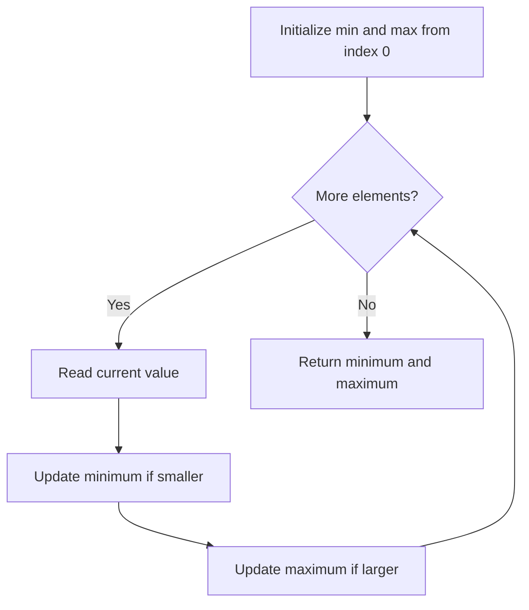

# Find array minimum and maximum

<!-- imported-study-material -->

> Imported lesson from [DSA coding course - Java and Python, lines 222–913](/research?document=dsa&start=222&end=913). Needs review: examples and claims retain their source context; reading does not certify proficiency.

## Lesson 1 — Find the largest and smallest elements in an array

Course #1

Original #1

Beginner

## A. Problem understanding

**Problem statement:** Given an array of integers, find its smallest and largest elements.

Example 1:

```text
Input:  [7, -3, 12, 12, 0]

Output:
Smallest = -3
Largest  = 12
```

Example 2:

```text
Input:  [-8, -4, -15, -2]

Output:
Smallest = -15
Largest  = -2
```

Notice that the largest negative number is the number closest to zero, not the one with the largest absolute value.

**Assumptions and constraints:**

- The array may contain positive, negative, zero, and duplicate values.
- Its size can be any nonnegative integer.
- For an empty array, our implementations will raise an error because neither minimum nor maximum is defined.
- We will not modify the original array.
- All Java values fit in the `int` type.

**What an interviewer tests:** Can you traverse an array, initialize variables correctly, compare values, and avoid unnecessary work?

## B. Prerequisite revision — Array traversal

Array traversal means visiting elements of an array, usually one after another.

### Java

```java
int[] arr = {10, 20, 30};

for (int i = 0; i < arr.length; i++) {
    System.out.println(arr[i]);
}
```

Here:

- `int[]` declares an integer array.
- `i = 0` starts at the first index.
- `i < arr.length` prevents accessing beyond the last element.
- `i++` increments the index by 1.
- `arr[i]` accesses the element at that index.

Java also supports an enhanced for-loop:

```java
for (int value : arr) {
    System.out.println(value);
}
```

This is useful when you need the values but not their indices.

### Python

```python
arr = [10, 20, 30]
for i in range(len(arr)):
    print(arr[i])
```

The expression `range(len(arr))` produces indices `0, 1, 2` for this example.

Python also allows direct iteration:

```python
for value in arr:
    print(value)
```

And when both the index and element are necessary:

```python
for i, value in enumerate(arr):
    print(i, value)
```

**Important performance facts:** An indexed read from a Java array or Python list is O(1). Traversing `n` elements is O(n). Appending to a Python list is amortized O(1), but inserting at the beginning is O(n) because existing references must be shifted.

## C. Pattern recognition — Linear scan

**Interview clue:** “Find the minimum, maximum, total, average, or count of values in an unsorted array.”

Usually, start by considering a single linear scan.

**Key observation:** You do not need to remember every previously examined element. You only need the smallest and largest values found so far.

This pattern is also useful for finding the highest salary, lowest temperature, maximum score, or count of qualifying transactions.

It is not sufficient when the interviewer asks for more structural information, such as all pairs with a particular relationship, sorted ordering, or every range maximum. Those problems may require additional data structures or patterns.

## D. Data structure choice

We use the original array and two variables.

| Operation                            | Java `int[]` | Python `list` |
| ------------------------------------ | ------------ | ------------- |
| Index access                         | O(1)         | O(1)          |
| Assign element                       | O(1)         | O(1)          |
| Full traversal                       | O(n)         | O(n)          |
| Search unsorted data                 | O(n)         | O(n)          |
| Additional minimum/maximum variables | O(1)         | O(1)          |

Why not use a HashMap, HashSet, or another array? Because the task requires only two values, not a collection of historical results.

Arrays give efficient sequential access and good locality. Java primitive arrays store primitive values directly; Python lists store references to objects, so their memory layouts differ.

## E. Brute-force solution — Check every candidate against every value

Imagine considering each element as a possible minimum or maximum.

For each candidate:

1. Compare it with every other array value.
2. If nothing is smaller than the candidate, it is a minimum.
3. If nothing is larger than the candidate, it is a maximum.
4. Repeat for every candidate.

This is correct but repeats many comparisons.

### Brute-force Java implementation

```java
public class Main {

    public static int[] findMinMaxBrute(int[] arr) {
        if (arr == null || arr.length == 0) {
            throw new IllegalArgumentException(
                "Array must not be empty"
            );
        }

        int minimum = arr[0];
        int maximum = arr[0];

        for (int candidate : arr) {
            boolean isMinimum = true;
            boolean isMaximum = true;

            for (int value : arr) {
                if (value < candidate) {
                    isMinimum = false;
                }

                if (value > candidate) {
                    isMaximum = false;
                }
            }

            if (isMinimum) {
                minimum = candidate;
            }

            if (isMaximum) {
                maximum = candidate;
            }
        }

        return new int[]{minimum, maximum};
    }

    public static void main(String[] args) {
        int[] arr = {7, -3, 12, 12, 0};

        int[] result = findMinMaxBrute(arr);

        System.out.println("Smallest = " + result[0]);
        System.out.println("Largest  = " + result[1]);
    }
}
```

### Brute-force Python implementation

```python
def find_min_max_brute(arr):
    if not arr:
        raise ValueError("Array must not be empty")
    minimum = arr[0]
    maximum = arr[0]
    for candidate in arr:
        is_minimum = True
        is_maximum = True
        for value in arr:
            if value < candidate:
                is_minimum = False
            if value > candidate:
                is_maximum = False
        if is_minimum:
            minimum = candidate
        if is_maximum:
            maximum = candidate
    return minimum, maximum

arr = [7, -3, 12, 12, 0]
minimum, maximum = find_min_max_brute(arr)
print("Smallest =", minimum)
print("Largest  =", maximum)
```

Both programs output:

```text
Smallest = -3
Largest  = 12
```

### Brute-force dry run

The input contains five values. Every candidate is checked against all five values, including itself.

| Candidate | Smaller value exists? | Larger value exists? | Result after checking candidate |
| --------- | --------------------- | -------------------- | ------------------------------- |
| `7`       | Yes, `-3` and `0`     | Yes, `12`            | Neither                         |
| `-3`      | No                    | Yes                  | Minimum = `-3`                  |
| `12`      | Yes                   | No                   | Maximum = `12`                  |
| `12`      | Yes                   | No                   | Maximum remains `12`            |
| `0`       | Yes                   | Yes                  | Neither                         |

For example, when candidate = `7`, the inner loop compares against `7`, `-3`, `12`, `12`, and `0`. The flags eventually become `false` and `false`, so it cannot be a minimum or maximum.

**Operation count:**

The outer loop runs `n` times.

For each outer iteration, the inner loop runs `n` times.

$$
 n\times n=n^2 
$$

There are two relational checks in each inner iteration:

$$
 C(n)=2n^2 
$$

For `n = 5`:

$$
 2(5^2)=50\text{ relational checks} 
$$

Other work, such as updating flags, is at most proportional to the same quadratic iteration count. Therefore:

- Best-case time: Θ(n²)
- Average-case time: Θ(n²)
- Worst-case time: Θ(n²)
- Auxiliary space: O(1), because only a fixed number of variables is stored.

Even if the elements are all identical, both loops still perform their full iteration counts.

## F. Optimized solution — Single traversal

The brute-force solution repeatedly compares candidates with elements that have already been checked.

We can avoid this repetition by remembering our best answers as we scan.

Initialize:

```text
minimum = first element
maximum = first element
```

For every remaining element:

```text
If current < minimum:
    update minimum

If current > maximum:
    update maximum
```

We now visit every element only once.

### Optimized Java implementation

```java
public class Main {

    public static int[] findMinMax(int[] arr) {
        if (arr == null || arr.length == 0) {
            throw new IllegalArgumentException(
                "Array must not be empty"
            );
        }

        int minimum = arr[0];
        int maximum = arr[0];

        for (int i = 1; i < arr.length; i++) {
            int current = arr[i];

            if (current < minimum) {
                minimum = current;
            }

            if (current > maximum) {
                maximum = current;
            }
        }

        return new int[]{minimum, maximum};
    }

    public static void main(String[] args) {
        int[] arr = {7, -3, 12, 12, 0};

        int[] result = findMinMax(arr);

        System.out.println("Smallest = " + result[0]);
        System.out.println("Largest  = " + result[1]);
    }
}
```

### Line-by-line explanation — Java

| Code                                        | Explanation                                                                                           |
| ------------------------------------------- | ----------------------------------------------------------------------------------------------------- |
| `public class Main`                         | Declares the class containing the program.                                                            |
| `public static int[] findMinMax(int[] arr)` | Creates a callable static method taking an integer array and returning an integer array.              |
| `if (arr == null \|\| arr.length == 0)`   | Rejects a null reference or empty array. Short-circuiting prevents reading `length` if `arr` is null. |
| `throw new IllegalArgumentException(...)`   | Signals that the method received invalid input.                                                       |
| `int minimum = arr[0]`                      | Initializes the smallest known value.                                                                 |
| `int maximum = arr[0]`                      | Initializes the largest known value.                                                                  |
| `int i = 1`                                 | Starts from the second element because index 0 has already been processed.                            |
| `i < arr.length`                            | Continues while `i` is a valid index.                                                                 |
| `i++`                                       | Advances by one position.                                                                             |
| `int current = arr[i]`                      | Reads the current value.                                                                              |
| `if (current < minimum)`                    | Checks whether a new smaller value has appeared.                                                      |
| `minimum = current`                         | Saves the new minimum.                                                                                |
| `if (current > maximum)`                    | Checks whether a new larger value has appeared.                                                       |
| `maximum = current`                         | Saves the new maximum.                                                                                |
| `return new int[]{minimum, maximum}`        | Creates and returns a two-element result array.                                                       |
| `int[] result = findMinMax(arr)`            | Calls the method and stores its result.                                                               |
| `result[0]`, `result[1]`                    | Retrieve the minimum and maximum respectively.                                                        |

Why initialize using `arr[0]` rather than zero?

Suppose:

```text
arr = [-9, -4, -12]
```

If `maximum = 0`, no array value would exceed it, and the algorithm would incorrectly return zero. Initializing from an actual element prevents this mistake.

### Optimized Python implementation

```python
def find_min_max(arr):
    if not arr:
        raise ValueError("Array must not be empty")
    minimum = arr[0]
    maximum = arr[0]
    for i in range(1, len(arr)):
        current = arr[i]
        if current < minimum:
            minimum = current
        if current > maximum:
            maximum = current
    return minimum, maximum

arr = [7, -3, 12, 12, 0]
minimum, maximum = find_min_max(arr)
print("Smallest =", minimum)
print("Largest  =", maximum)
```

### Line-by-line explanation — Python

| Code                                   | Explanation                                          |
| -------------------------------------- | ---------------------------------------------------- |
| `def find_min_max(arr):`               | Defines a function that accepts a list.              |
| `if not arr:`                          | Checks whether the list is empty or otherwise falsy. |
| `raise ValueError(...)`                | Raises an exception for invalid input.               |
| `minimum = arr[0]`                     | Stores the first element as the initial minimum.     |
| `maximum = arr[0]`                     | Stores the first element as the initial maximum.     |
| `range(1, len(arr))`                   | Produces index values 1 through `len(arr)-1`.        |
| `current = arr[i]`                     | Reads the current element.                           |
| `if current < minimum:`                | Tests for a smaller element.                         |
| `minimum = current`                    | Updates the minimum.                                 |
| `if current > maximum:`                | Tests for a larger element.                          |
| `maximum = current`                    | Updates the maximum.                                 |
| `return minimum, maximum`              | Returns a tuple containing the two values.           |
| `minimum, maximum = find_min_max(arr)` | Unpacks that tuple into two variables.               |
| `print(...)`                           | Displays the results.                                |

In both languages, the comparison logic is identical.

## G. Mathematical complexity derivation

The first element initializes two variables. The loop then processes the remaining `n - 1` elements.

For each element:

- One comparison with `minimum`.
- One comparison with `maximum`.
- Zero or one assignment to update those values; a current value cannot be both below the minimum and above the maximum.

Therefore:

$$
 C(n)=2(n-1)=2n-2 
$$

For five elements:

$$
 C(5)=2(4)=8 
$$

For one million elements:

$$
 C(1{,}000{,}000)=1{,}999{,}998 
$$

The number of comparisons grows linearly.

$$
 T(n)=a(n-1)+b=\Theta(n) 
$$

The algorithm uses two main tracking variables, one index, and one current value:

$$
 S(n)=\Theta(1) 
$$

Comparison growth: brute force versus optimized


| n | Brute force: 2n² | Optimized: 2(n−1) |
| --- | --- | --- |
| 1 | 2 | 0 |
| 5 | 50 | 8 |
| 10 | 200 | 18 |
| 20 | 800 | 38 |
| 50 | 5000 | 98 |

Counts include the two relational checks per compared element.

The optimized solution has best-, average-, and worst-case time Θ(n) because it always completes a full pass. Its worst-case optimality follows from the fact that an unseen element might be the smallest or largest, so every input value must be inspected in the general comparison model.

## H. Detailed optimized dry run — Same for Java and Python

### Interactive traversal

[Open the step-by-step traversal](/practice/arrays). Initial state: array `[7, -3, 12, 12, 0]`, index `0`, current/minimum/maximum `7`, processed `1/5`. Use Previous and Next to inspect each state.



Full tracing table:

| Step    | Index | Current | Compare against min/max | Min after | Max after |
| ------- | ----- | ------- | ----------------------- | --------- | --------- |
| Initial | 0     | 7       | Initialize              | 7         | 7         |
| 1       | 1     | -3      | -3 < 7, -3 > 7?         | -3        | 7         |
| 2       | 2     | 12      | 12 < -3?, 12 > 7        | -3        | 12        |
| 3       | 3     | 12      | 12 < -3?, 12 > 12?      | -3        | 12        |
| 4       | 4     | 0       | 0 < -3?, 0 > 12?        | -3        | 12        |

The answers to the comparisons are, respectively: `(true, false)`, `(false, true)`, `(false, false)`, and `(false, false)`.

### Why the algorithm is correct

After each iteration, maintain this invariant:

`minimum`** and **`maximum`** are the actual smallest and largest values in the processed prefix of the array.**

It is initially true for the first element. Each new element can only change the minimum if it is smaller, or the maximum if it is larger. Therefore the invariant remains true after every step.

Once every element is processed, the prefix is the entire array, so both answers must be correct.

## I. Java versus Python

| Topic             | Java                        | Python                      |
| ----------------- | --------------------------- | --------------------------- |
| Array/list        | `int[]`                     | `list`                      |
| Length            | `arr.length`                | `len(arr)`                  |
| Error             | `IllegalArgumentException`  | `ValueError`                |
| Return values     | `new int[]{min, max}`       | `(min, max)` tuple          |
| Number type       | 32-bit signed `int`         | Arbitrary-precision integer |
| Result extraction | `result[0]` and `result[1]` | Tuple unpacking             |
| Algorithmic time  | Θ(n)                        | Θ(n)                        |
| Auxiliary space   | O(1)                        | O(1)                        |

Python offers built-ins `min(arr)` and `max(arr)`. Java has utilities such as `Arrays.stream(arr).min()` and `.max()`. These are useful in applications, but coding tests often expect you to implement the traversal itself.

## J. Edge cases

| Input                       | Expected result          |
| --------------------------- | ------------------------ |
| `[5]`                       | Min 5, max 5             |
| `[4, 4, 4]`                 | Min 4, max 4             |
| `[-10, -3, -7]`             | Min -10, max -3          |
| `[0, 0, 1]`                 | Min 0, max 1             |
| `[9, 2]`                    | Min 2, max 9             |
| `[2, 9]`                    | Min 2, max 9             |
| `[]`                        | Exception                |
| `[2147483647, -2147483648]` | Correct extremes in Java |

No arithmetic is performed on the numbers, so merely having `Integer.MIN_VALUE` or `Integer.MAX_VALUE` does not create an overflow.

## K. Common interview mistakes

1. **Starting with zero:** Incorrect when every value is negative or positive in the relevant direction.
2. **Using **`i <= arr.length`**:** The last valid index is `arr.length - 1`.
3. **Forgetting the empty array:** Accessing `arr[0]` fails when the array is empty.
4. **Replacing max/min unconditionally:** Update only after the appropriate comparison.
5. **Confusing average-case and worst-case:** This optimized implementation performs the same number of comparisons in every valid array of a fixed size.
6. **Reporting O(n) auxiliary space:** The input array is not extra working memory created by this algorithm.

## L. Memory technique

**Mnemonic: “Assume → Scan → Compare → Update.”**

The reusable template is:

```java
int best = arr[0];

for (int i = 1; i < arr.length; i++) {
    if (arr[i] > best) {
        best = arr[i];
    }
}
```

```python
best = arr[0]
for i in range(1, len(arr)):
    if arr[i] > best:
        best = arr[i]
```

To derive the minimum version, reverse the comparison. To find both, maintain two tracking variables.

## M. Practice problems — Attempt in both languages

Practice set 1

**1. Easy**

Find the first index of the minimum and first index of the maximum in an array.

**2. Easy–Medium**

Count how many times the minimum and maximum values occur in an array.

**3. Medium**

Given a rectangular 2D integer matrix, find its minimum and maximum using traversal, without sorting.

Check off a question when you have attempted it. These local checkboxes are not an assessment score; solutions will be evaluated when you submit your code.

For each exercise, provide both Java and Python code, and state time and auxiliary space complexity.

## N. Knowledge check — No answer key yet

**Lesson 1 quiz**

[Open array practice (original quiz attachment not supplied)](/practice/arrays). Initial progress: 0/7 answered.

1\. What is the time complexity of visiting all n array elements exactly once?

A. O(1)

B. O(log n)

C. O(n)

D. O(n²)

2\. Why is initializing maximum to 0 potentially incorrect?

A. Zero is always the smallest integer

B. The input may contain only negative values

C. It changes the array

D. The loop will never execute

3\. What is the final valid index of an array of length 7?

A. 7

B. 6

C. 8

D. 1

4\. What is the auxiliary space complexity of maintaining two integer trackers?

A. O(1)

B. O(n)

C. O(n log n)

D. O(n²)

5\. Which Java property obtains an array's length?

A. arr.size()

B. len(arr)

C. arr.length

D. arr.length()

6\. What does `return minimum, maximum` return in Python?

A. A dictionary

B. A tuple

C. A set

D. Two independently returned objects

7\. For n = 6, how many relational comparisons does our optimized method perform after initialization?

A. 6

B. 10

C. 12

D. 36

Select answers and submit in the interactive quiz for local grading.

## O. Lesson 1 revision notes

| Item             | Key fact                                             |
| ---------------- | ---------------------------------------------------- |
| Problem          | Find min/max                                         |
| Pattern          | Linear traversal                                     |
| Data structure   | Array / Python list                                  |
| Brute force      | Θ(n²) time, O(1) auxiliary space                     |
| Optimized        | Θ(n) time, O(1) auxiliary space                      |
| Java template    | `int min = arr[0];` followed by scan and comparisons |
| Python template  | `minimum = arr[0]` followed by scan and comparisons  |
| Important rule   | Initialize from real input data                      |
| Related problems | Second largest, frequency counting, move zeros       |

**Lesson status:** 

Taught · Assessment pending

## Connected study

Continue with [data structures](/knowledge/data-structures) and the [complete study library](/study).
