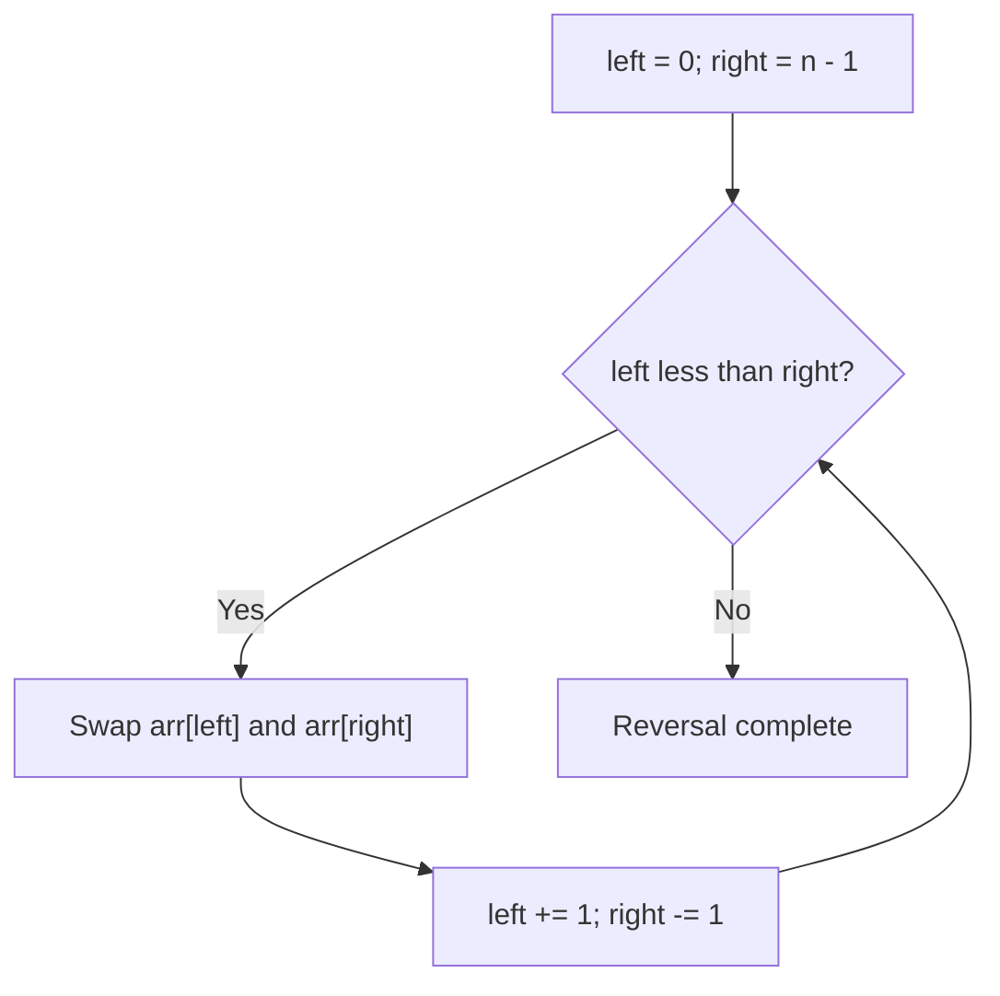

# Reverse an array with two pointers

<!-- imported-study-material -->

> Imported lesson from [DSA coding course - Java and Python, lines 1533–2304](/research?document=dsa&start=1533&end=2304). Needs review: examples and claims retain their source context; reading does not certify proficiency.

## Lesson 3 — Reverse an array using two pointers

Course #3 · Original #3 · Beginner

This lesson introduces one of the most important coding interview patterns: **two pointers**.

The previous two problems required reading array elements and maintaining variables. Now we will modify an array by manipulating two indices.

## A. Problem understanding

Given an array of integers, reverse the order of its elements.

Example 1:

```text
Input:  [3, 8, -1, 0, 5]
Output: [5, 0, -1, 8, 3]
```

Example 2:

```text
Input:  [10, 20, 30, 40]
Output: [40, 30, 20, 10]
```

Important distinction: Reversing an array means changing the order of elements, not sorting them in descending order.

For example:

```text
Original:          [3, 9, 1, 7]
Reversed:          [7, 1, 9, 3]
Descending sorted: [9, 7, 3, 1]
```

These are different operations.

The interviewer may ask for either:

- A reversed copy, where the original array remains unchanged.
- **In-place reversal**, where the original array is modified using O(1) extra memory.

We will implement both approaches.

## B. Prerequisite revision — Indices, swapping, and mutability

### What is swapping?

Swapping means exchanging the values stored in two locations.

Suppose:

```text
a = 10
b = 20
```

After swapping:

```text
a = 20
b = 10
```

### Java swapping

```java
int a = 10;
int b = 20;

int temp = a;
a = b;
b = temp;
```

Why do we need `temp`?

If we write:

```java
a = b;
b = a;
```

Both variables become `20`, because the original `a` is overwritten before it can be assigned to `b`.

### Python swapping

Python supports tuple assignment:

```text
a = 10b = 20a, b = b, a
```

Python evaluates the right-hand side before assigning the resulting values to the destinations, preserving the original values needed for the swap.

### What are two pointers?

Two pointers are two variables used to keep track of positions within a data structure.

For array reversal:

- `left` starts at index `0`.
- `right` starts at index `n - 1`.
- We swap their elements.
- `left` moves right.
- `right` moves left.

Two-pointer movement

The word *pointer* here means an index variable. Neither Java nor Python uses direct C-style memory pointers in this implementation.

### Java and Python mutability

A Java array is mutable:

```java
int[] arr = {1, 2, 3};
arr[0] = 9;
```

A Python list is also mutable:

```text
arr = [1, 2, 3]arr[0] = 9
```

Both now contain `[9, 2, 3]`.

However, Python tuples and strings are immutable. We cannot directly swap their elements in place.

## C. Pattern recognition

Look for interview phrases such as:

- “Reverse in place.”
- “Use constant extra space.”
- “Swap the first and last elements.”
- “Process the array from both ends.”
- “Reverse a subarray.”

These are clues for the **opposite-end two-pointer pattern**.

The pattern is useful when the problem has a relationship between the left and right ends of a sequence. It will reappear in palindrome checking and other array problems.

It is not always the best pattern. For example, a running sum generally needs only one traversal variable. A problem requiring preservation of the original array may need a new output buffer.

## D. Data structure explanation

| Operation              | Java array            | Python list           |
| ---------------------- | --------------------- | --------------------- |
| Read left element      | `arr[left]`           | `arr[left]`           |
| Read right element     | `arr[right]`          | `arr[right]`          |
| Change a position      | O(1)                  | O(1)                  |
| Swap two positions     | O(1)                  | O(1)                  |
| Create a reversed copy | O(n) memory           | O(n) memory           |
| Reverse in place       | O(1) auxiliary memory | O(1) auxiliary memory |

Java arrays have fixed length. Python lists can grow or shrink, but our reversal algorithm does not change their length.

In both languages, if two variables refer to the same array or list, an in-place reversal through one reference will be visible through the other reference.

## E. Brute-force solution — Create a reversed copy

The simplest approach is to create another array of the same size.

For input size `n`, the reversed element at index `i` comes from original index:

$$
 n-1-i 
$$

For an array of five elements:

| New index `i` | Original index `n-1-i` |
| ------------- | ---------------------- |
| 0             | 4                      |
| 1             | 3                      |
| 2             | 2                      |
| 3             | 1                      |
| 4             | 0                      |

### Brute-force Java implementation

```java
import java.util.Arrays;

public class Main {

    public static int[] reversedCopy(int[] arr) {
        if (arr == null) {
            throw new IllegalArgumentException(
                "Array cannot be null"
            );
        }

        int n = arr.length;

        int[] reversed = new int[n];

        for (int i = 0; i < n; i++) {
            reversed[i] = arr[n - 1 - i];
        }

        return reversed;
    }

    public static void main(String[] args) {
        int[] arr = {3, 8, -1, 0, 5};

        int[] result = reversedCopy(arr);

        System.out.println(
            "Original: " + Arrays.toString(arr)
        );

        System.out.println(
            "Reversed: " + Arrays.toString(result)
        );
    }
}
```

Output:

```text
Original: [3, 8, -1, 0, 5]
Reversed: [5, 0, -1, 8, 3]
```

Here `Arrays.toString()` converts the array elements into a readable string. Printing an `int[]` directly would display a type-and-identity representation rather than its contents.

### Brute-force Python implementation

```python
def reversed_copy(arr):
    n = len(arr)
    reversed_arr = [0] * n
    for i in range(n):
        reversed_arr[i] = arr[n - 1 - i]
    return reversed_arr

arr = [3, 8, -1, 0, 5]
result = reversed_copy(arr)
print("Original:", arr)
print("Reversed:", result)
```

Output:

```text
Original: [3, 8, -1, 0, 5]
Reversed: [5, 0, -1, 8, 3]
```

`[0] * n` creates a list containing `n` zero values. We subsequently replace each value with its corresponding reversed element.

### Brute-force dry run — Both languages

Input = `[3, 8, -1, 0, 5]`

Initially:

`reversed = [?, ?, ?, ?, ?]`

| Iteration | `i` | `n - 1 - i` | Value copied | Reversed array after assignment |
| --------- | --- | ----------- | ------------ | ------------------------------- |
| 1         | 0   | 4           | 5            | `[5, ?, ?, ?, ?]`               |
| 2         | 1   | 3           | 0            | `[5, 0, ?, ?, ?]`               |
| 3         | 2   | 2           | -1           | `[5, 0, -1, ?, ?]`              |
| 4         | 3   | 1           | 8            | `[5, 0, -1, 8, ?]`              |
| 5         | 4   | 0           | 3            | `[5, 0, -1, 8, 3]`              |

The placeholders in the table represent positions not yet filled with their final values. In the actual Java array and Python list, those positions initially contain zeros.

### Complexity calculation

The loop performs `n` iterations, one source read and one destination write per iteration.

$$
 T(n)=cn+d=\Theta(n) 
$$

The new array stores `n` values.

$$
 M(n)=\Theta(n) 
$$

This is O(n) additional allocated memory relative to the original input. Under a convention that excludes the required output buffer from *auxiliary* space, its auxiliary space is O(1); however, total extra allocated memory is still O(n).

Best, average, and worst-case times are all Θ(n) because every element is copied.

This approach is not inherently a bad algorithm. It is preferable when the input must remain unchanged. We call it the baseline or brute-force solution here because it does not meet an in-place requirement.

## F. Optimized solution — Swap from both ends

We can reverse the array without allocating another array.

Algorithm:

1. Start `left = 0`.
2. Start `right = n - 1`.
3. While `left < right`, exchange `arr[left]` and `arr[right]`.
4. Increase `left`.
5. Decrease `right`.
6. Stop when the pointers meet or cross.

### Optimized Java implementation

```java
import java.util.Arrays;

public class Main {

    public static void reverseInPlace(int[] arr) {
        if (arr == null) {
            throw new IllegalArgumentException(
                "Array cannot be null"
            );
        }

        int left = 0;
        int right = arr.length - 1;

        while (left < right) {

            int temp = arr[left];

            arr[left] = arr[right];

            arr[right] = temp;

            left++;
            right--;
        }
    }

    public static void main(String[] args) {
        int[] arr = {3, 8, -1, 0, 5};

        System.out.println(
            "Before: " + Arrays.toString(arr)
        );

        reverseInPlace(arr);

        System.out.println(
            "After:  " + Arrays.toString(arr)
        );
    }
}
```

Output:

```text
Before: [3, 8, -1, 0, 5]
After:  [5, 0, -1, 8, 3]
```

### Java line-by-line explanation

| Code                                           | Explanation                                                           |
| ---------------------------------------------- | --------------------------------------------------------------------- |
| `import java.util.Arrays;`                     | Provides the `Arrays.toString()` formatting utility.                  |
| `public class Main`                            | Declares our program class.                                           |
| `public static void reverseInPlace(int[] arr)` | Declares a static method that modifies an array and returns no value. |
| `if (arr == null)`                             | Rejects an invalid null array reference.                              |
| `int left = 0`                                 | Starts the first pointer at the beginning.                            |
| `int right = arr.length - 1`                   | Starts the second pointer at the last valid index.                    |
| `while (left < right)`                         | Continues until the two pointers meet or cross.                       |
| `int temp = arr[left]`                         | Temporarily saves the left element.                                   |
| `arr[left] = arr[right]`                       | Copies the right element into the left position.                      |
| `arr[right] = temp`                            | Places the original left element at the right position.               |
| `left++`                                       | Moves the left pointer inward.                                        |
| `right--`                                      | Moves the right pointer inward.                                       |
| `reverseInPlace(arr)`                          | Calls the method and mutates the original array.                      |

**Why is the return type **`void`**?**

Because this method modifies the array passed to it. It does not need to construct and return a new array.

Java passes the value of the array reference to the method. This lets the method modify the same array object that the caller sees, although reassigning the local reference would not reassign the caller's variable.

### Optimized Python implementation

```python
def reverse_in_place(arr):
    left = 0
    right = len(arr) - 1
    while left < right:
        arr[left], arr[right] = arr[right], arr[left]
        left += 1
        right -= 1

arr = [3, 8, -1, 0, 5]
print("Before:", arr)
reverse_in_place(arr)
print("After: ", arr)
```

Output:

```text
Before: [3, 8, -1, 0, 5]
After:  [5, 0, -1, 8, 3]
```

### Python line-by-line explanation

| Code                                            | Explanation                                                   |
| ----------------------------------------------- | ------------------------------------------------------------- |
| `def reverse_in_place(arr):`                    | Defines the function accepting a mutable list.                |
| `left = 0`                                      | Initializes the left index.                                   |
| `right = len(arr) - 1`                          | Initializes the final index.                                  |
| `while left < right:`                           | Repeats while two different positions still require swapping. |
| `arr[left], arr[right] = arr[right], arr[left]` | Exchanges the two list elements.                              |
| `left += 1`                                     | Moves the left index one step right.                          |
| `right -= 1`                                    | Moves the right index one step left.                          |
| `reverse_in_place(arr)`                         | Calls the function, modifying the same list.                  |

The function implicitly returns `None`.

### Important Java versus Python observation

Java uses a temporary variable explicitly:

```java
int temp = arr[left];
arr[left] = arr[right];
arr[right] = temp;
```

Python can use a single assignment:

```python
arr[left], arr[right] = arr[right], arr[left]
```

The algorithm remains the same: read both values and exchange them. Python's concise syntax does not change the Θ(1) cost of an individual swap.

## G. Mathematical and algorithmic calculations

We swap two elements during each iteration.

If the array has an even number of elements, every element participates in exactly one swap.

If it has an odd number of elements, the middle element stays in its original position.

The number of swaps is:

$$
 \text{Swaps}(n)=\left\lfloor\frac n2\right\rfloor 
$$

Examples:

| Array length | Number of swaps |
| ------------ | --------------- |
| 0            | 0               |
| 1            | 0               |
| 2            | 1               |
| 5            | 2               |
| 6            | 3               |
| 10           | 5               |
| 101          | 50              |

Each swap uses a constant number of operations.

In Java, the swap itself uses three assignments. The two pointer updates add two more operations.

Ignoring loop-control overhead:

$$
 T(n)\approx 5\left\lfloor\frac n2\right\rfloor 
$$

Therefore, for sufficiently large `n`:

$$
 T(n)=\Theta(n) 
$$

The Java method stores three principal working integers: `left`, `right`, and `temp`.

The Python version stores the two indices and uses constant-sized temporary references during assignment.

Consequently:

$$
 S(n)=\Theta(1) 
$$

For arrays with `n ≥ 2`, the best, average, and worst-case running time is Θ(n). For arrays containing zero or one element, the algorithm completes in O(1).

### Why stop at left < right?

If `left == right`, both indices refer to the same middle element. Swapping it with itself is unnecessary.

If `left > right`, the two sides have already been processed.

Using `left <= right` would perform an unnecessary self-swap on odd-length arrays, although it would still produce the correct answer.

## H. Complete dry run — Both optimized implementations

Consider:

`arr = [3, 8, -1, 0, 5]`

### Two-pointer swap simulator

[Open the swap simulator](/practice/arrays). Initial array: `[3, 8, -1, 0, 5]`; left `0`, right `4`, swap `0/2`. Previous and Next step through both swaps.



### Swap 1

Initial:

```text
Index:   0   1   2   3   4
Array:  [3,  8, -1,  0,  5]
         L               R
```

Pointer values:

```text
left  = 0
right = 4
```

Java performs:

```text
temp = arr[0]       = 3
arr[0] = arr[4]     = 5
arr[4] = temp       = 3
```

Python performs the same swap with its multiple-assignment syntax.

After swap 1:

```text
[5, 8, -1, 0, 3]
```

Then:

```text
left  = 1
right = 3
```

### Swap 2

Current:

```text
Index:   0   1   2   3   4
Array:  [5,  8, -1,  0,  3]
             L       R
```

Exchange elements at indices 1 and 3:

```text
temp = 8
arr[1] = 0
arr[3] = 8
```

Result:

```text
[5, 0, -1, 8, 3]
```

Then:

```text
left  = 2
right = 2
```

The condition `left < right` is now false.

### Final tracing table

| Iteration | Left | Right | Elements swapped | Array afterward    |
| --------- | ---- | ----- | ---------------- | ------------------ |
| Initial   | 0    | 4     | None             | `[3, 8, -1, 0, 5]` |
| 1         | 0    | 4     | 3 and 5          | `[5, 8, -1, 0, 3]` |
| 2         | 1    | 3     | 8 and 0          | `[5, 0, -1, 8, 3]` |
| Stop      | 2    | 2     | None             | `[5, 0, -1, 8, 3]` |

The middle value `-1` remains where it was, which is correct for an odd-length array.

### Why the optimized algorithm is correct

The key invariant is:

**Before each swap, the portions outside **`left`** and **`right`** already contain their correct values in the reversed array.**

Initially, no positions have been processed. Swapping the two ends puts both values into their final reversed positions. The pointers then move inward, leaving those positions untouched.

By repeating this operation, we put two more positions into their final locations during each iteration. When the pointers meet or cross, every position is correct.

## I. Java versus Python comparison

| Feature                    | Java                              | Python                    |
| -------------------------- | --------------------------------- | ------------------------- |
| Mutable input              | `int[]`                           | `list`                    |
| Last index                 | `arr.length - 1`                  | `len(arr) - 1`            |
| Swapping                   | Temporary variable                | Multiple assignment       |
| Pointer movement           | `left++`, `right--`               | `left += 1`, `right -= 1` |
| Return for in-place method | `void`                            | Implicit `None`           |
| Built-in reverse option    | `Collections.reverse()` for lists | `arr.reverse()` for lists |
| Slicing reversed copy      | Not available directly on arrays  | `arr[::-1]`               |
| Time complexity            | Θ(n)                              | Θ(n)                      |
| Extra memory               | O(1)                              | O(1)                      |

Python's `arr[::-1]` creates a new list and requires O(n) additional memory. `arr.reverse()` modifies the list in place.

In Java, `Collections.reverse()` works with a `List`, not directly with primitive `int[]`. You can reverse a Java `ArrayList<Integer>` using it, but for an `int[]`, the two-pointer method shown above is straightforward.

## J. Edge cases

| Input                       | Expected reversed output    |
| --------------------------- | --------------------------- |
| `[]`                        | `[]`                        |
| `[5]`                       | `[5]`                       |
| `[1, 2]`                    | `[2, 1]`                    |
| `[1, 2, 3]`                 | `[3, 2, 1]`                 |
| `[7, 7, 7]`                 | `[7, 7, 7]`                 |
| `[-1, 0, 5]`                | `[5, 0, -1]`                |
| `[4, 3, 2, 1]`              | `[1, 2, 3, 4]`              |
| `[2147483647, -2147483648]` | `[-2147483648, 2147483647]` |

Neither implementation performs arithmetic on the element values themselves. Therefore integer overflow is not a concern for reversing ordinary `int` array elements.

## K. Common mistakes and interview traps

**1. Initializing **`right = arr.length`**.**

This is invalid for nonempty arrays because the last index is `arr.length - 1`.

**2. Moving both pointers in the same direction.**

For opposite-end reversal:

```text
left  moves right (+1)
right moves left  (-1)
```

If both indices increase, they will not converge correctly.

**3. Forgetting the temporary variable in Java.**

Overwriting one value before saving it destroys information needed for the swap.

**4. Assuming in-place and copied reversal have the same memory cost.**

Both require Θ(n) time, but the new-copy approach allocates Θ(n) memory while the in-place method uses Θ(1) auxiliary memory.

**5. Confusing references and copies.**

In Python:

```python
a = [1, 2, 3]
b = a
```

Both variables refer to the same list. Reversing `b` in place also changes what you observe through `a`.

Similarly, a Java variable assigned another array reference does not automatically create a copy of the array.

**6. Using Python slicing without checking the requirement.**

`arr[::-1]` is concise and correct for creating a reversed copy, but it does not satisfy an O(1)-extra-space in-place reversal requirement.

## L. Memory technique

**Mnemonic: “Swap ends → Move inward → Stop at center.”**

The reusable two-pointer template is:

Java:

```java
int left = 0;
int right = arr.length - 1;

while (left < right) {
    // Process arr[left] and arr[right]

    left++;
    right--;
}
```

Python:

```python
left = 0
right = len(arr) - 1
while left < right:
    # Process arr[left] and arr[right]
    left += 1
    right -= 1
```

The processing step changes depending on the problem.

For reversal, swap the elements.

For palindrome checking, compare the elements.

This is why we study array reversal immediately before palindrome checking.

## M. Practice problems

Attempt each question in both languages.

1. **Easy — Reverse a subarray:** Given an array and two valid indices `left` and `right`, reverse only the elements between those indices, inclusive, without modifying the other elements.
2. **Medium — Reverse characters:** Given a mutable sequence of characters, reverse it in place. Consider differences between Java's character arrays and Python's lists of characters.
3. **Medium–Hard — Rotate right by k:** Given an array of length `n` and a nonnegative integer `k`, rotate it right by `k` positions using O(1) auxiliary memory. For example, input `[1,2,3,4,5]` and `k=2` should produce `[4,5,1,2,3]`.

Do not use built-in reversal methods for the first attempt. Trace your pointer movements manually.

## N. Knowledge check

Answer without running code.

1. What are the initial `left` and `right` values for an array of length 8?
2. How many swaps are required to reverse an array of length 9?
3. Why does the two-pointer reversal stop when `left >= right`?
4. What happens if you write `arr[left] = arr[right]` followed immediately by `arr[right] = arr[left]` without preserving the original left value?
5. What is the extra memory complexity of an in-place reversal?
6. Is `arr[::-1]` in Python an in-place operation? Explain.
7. If `a` and `b` refer to the same mutable array/list and you reverse through `b`, what happens to the elements visible through `a`?
8. What is the result of reversing `[2, 5, 7, 9, 1, 4]` after exactly two swaps of the two-pointer algorithm?

## O. Lesson 3 revision notes

| Item               | Key fact                                     |
| ------------------ | -------------------------------------------- |
| Problem            | Reverse an array                             |
| Pattern            | Opposite-end two pointers                    |
| Data structure     | Mutable array / list                         |
| Baseline solution  | Θ(n) time, O(n) extra allocated memory       |
| Optimized solution | Θ(n) time, O(1) auxiliary space              |
| Number of swaps    | `floor(n / 2)`                               |
| Java template      | `while (left < right)` with `temp` swap      |
| Python template    | `while left < right` with tuple assignment   |
| Important rule     | Move pointers inward after every swap        |
| Related problems   | Palindrome, reverse subarray, array rotation |

**Lesson status:** Taught; practice and knowledge assessment pending.

## Connected study

Continue with [data structures](/knowledge/data-structures) and the [complete study library](/study).
