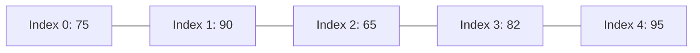

# Arrays and indexing

## Read the picture

An array is an ordered, indexable collection. The element's value and its position are different: in the picture, index 0 holds 3. For an array of length n with zero-based indexing, the final valid index is n-1.

Java arrays have fixed length after allocation; Python lists are resizable sequences. These implementations differ even when both support index-based examples. See [Java arrays](https://docs.oracle.com/javase/tutorial/java/nutsandbolts/arrays.html) and [Python data structures](https://docs.python.org/3/tutorial/datastructures.html) for language-specific behavior.

For the input [3, 8, -1, 0, 5], reversal produces [5, 0, -1, 8, 3]. First swap positions 0 and 4, then positions 1 and 3. The middle element stays in place. [Step through each swap](/practice/arrays) or read the [complete implementations](/knowledge/array-reversal).

<!-- imported-study-material -->

> Imported lesson from [DSA coding course - Java and Python, lines 65–109](/research?document=dsa&start=65&end=109). Needs review: examples and claims retain their source context; reading does not certify proficiency.

## 0.1 What is a data structure?

A **data structure** is a way to organize and store data so that we can access, modify, search, or process it efficiently.

For example, suppose you have five marks:

`[75, 90, 65, 82, 95]`

Instead of creating five independent variables, you store them in an array or list. This makes it possible to access elements through indices and process them with a loop.

### Java arrays versus Python lists

| Feature             | Java `int[]`                      | Python `list`               |
| ------------------- | --------------------------------- | --------------------------- |
| Example             | `int[] a = {5, 8, 2};`            | `a = [5, 8, 2]`             |
| First index         | `a[0]`                            | `a[0]`                      |
| Length              | `a.length`                        | `len(a)`                    |
| Change an element   | `a[1] = 10;`                      | `a[1] = 10`                 |
| Size                | Fixed length                      | Dynamically resizable       |
| Element storage     | Contiguous primitive `int` values | Array of object references  |
| Mixed element types | Not in a primitive `int[]`        | Allowed                     |
| Negative indexing   | Not supported                     | `a[-1]` is the last element |
| Fast index access   | O(1)                              | O(1)                        |

A Python list is conceptually closer to Java's `ArrayList<Integer>` than to a primitive `int[]`, although there are important implementation and memory differences.

## 0.2 How indices work

Example: Array of five elements

For an array containing `n` elements:

- First valid index: `0`
- Last valid index: `n - 1`
- Total valid indices: `n`
- Index `n` is out of bounds.

For `n = 5`, valid indices are `0, 1, 2, 3, 4`.

## Connected study

Continue with [data structures](/knowledge/data-structures) and the [complete study library](/study).
