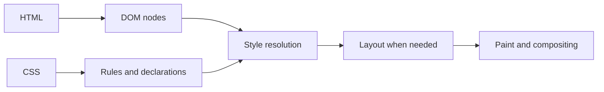

# CSS Object Model

The CSS Object Model (CSSOM) is a set of interfaces for representing and manipulating CSS. It exposes stylesheets, rules and declarations; it is not the browser's final pixel image.

## From rules to a rendered page

The [DOM](/knowledge/dom) supplies document structure. CSS rules, inheritance and the cascade determine styles for elements. [Browser rendering](/knowledge/browser-rendering) then determines geometry and visual output.



## Example: specified versus resolved style

Run in a browser page:

```javascript
const box = document.createElement('div');
box.style.width = '120px';
box.style.display = 'block';
document.body.append(box);
console.log(box.style.width);
box.remove();
```

Output: `120px`. The `style` property exposes inline declarations. `getComputedStyle(box)` reads resolved styles, which can include stylesheet and inherited values. Read it before removing the element if you want to investigate its attached-page styling.

## Corrections to the research

Not every style update causes layout and paint. The required work depends on the property and browser implementation. Relevant stylesheets can block rendering; saying that every stylesheet must always finish before any rendering is too broad. CSSOM, computed styles and a render tree are related concepts, not interchangeable names.

Learn [CSS](/knowledge/css) first, then use [DevTools](/knowledge/browser-devtools) to observe actual style and layout work. References: [CSSOM overview](https://developer.mozilla.org/en-US/docs/Web/API/CSS_Object_Model), [rendering performance](https://web.dev/articles/rendering-performance).
