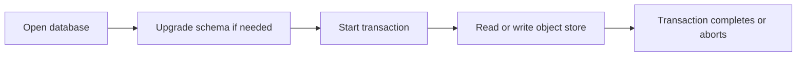

# IndexedDB

IndexedDB is an asynchronous browser database API for structured records, object stores and indexes. Reads and writes operate through transactions. It is appropriate for larger local application data and offline workflows.

## Request and transaction lifecycle



## Complete write example

Run on a disposable test origin. This intentionally persists one demonstration record:

```javascript
const request = indexedDB.open('codex-example-notes', 1);
request.onupgradeneeded = () => {
  request.result.createObjectStore('notes', { keyPath: 'id' });
};
request.onerror = () => console.error(request.error);
request.onblocked = () => console.log('Close older connections and retry');
request.onsuccess = () => {
  const db = request.result;
  db.onversionchange = () => db.close();
  const tx = db.transaction('notes', 'readwrite');
  tx.objectStore('notes').put({ id: 'first', text: 'Learn transactions' });
  tx.oncomplete = () => { console.log('Saved first'); db.close(); };
  tx.onabort = () => { console.error(tx.error); db.close(); };
};
```

Successful output: `Saved first`, after transaction completion. Opening a newer schema can be blocked by older connections. Avoid waiting on unrelated asynchronous work inside a transaction: it may become inactive. Handle quota failures and plan exports for important records.

The research's generic storage wrapper leaves this branch unfinished. An empty branch does not save anything. Learn [database transactions](/knowledge/database-transactions) and compare [local storage](/knowledge/local-storage). Reference: [MDN Using IndexedDB](https://developer.mozilla.org/en-US/docs/Web/API/IndexedDB_API/Using_IndexedDB).
