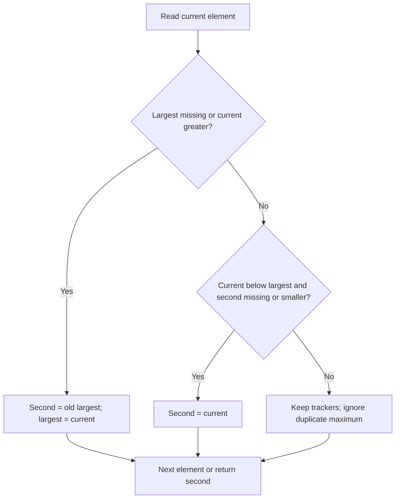

# Second-largest distinct value

<!-- imported-study-material -->

> Imported lesson from [DSA coding course - Java and Python, lines 914–1532](/research?document=dsa&start=914&end=1532). Needs review: examples and claims retain their source context; reading does not certify proficiency.

## Lesson 2 — Find the second-largest distinct element

Course #2 · Original #2 · Beginner

This lesson extends the previous algorithm. Instead of tracking only the largest value, we will maintain the **largest and second-largest distinct values**.

## A. Problem understanding

Given an unsorted integer array, find the second-largest *distinct* element.

Example 1:

```text
Input:  [4, 9, 1, 9, 7, -2]
Output: 7
```

The largest value is `9`, and the second-largest distinct value is `7`.

Example 2:

```text
Input:  [5, 5, 5]
Output: No second-largest distinct value
```

Although there are three elements, there is only one unique value.

Example 3:

```text
Input:  [-10, -3, -7, -3]
Output: -7
```

Sorted distinct values would be `[-10, -7, -3]`, so the second-largest is `-7`.

**Our contract:** Return Java `null` or Python `None` if no second distinct value exists. A null *array reference* in Java is treated as invalid input.

This problem tests logical conditions, duplicate handling, variable updates, and how to keep track of the top two values efficiently.

## B. Prerequisite revision — Maintaining multiple trackers

In Lesson 1, we stored one largest value. Now we store two:

```text
largest = ?
secondLargest = ?
```

Consider the sequence:

`4, 9, 1, 9, 7`

When we read `4`, it is the only known distinct value.

When we read `9`, it becomes the largest, and `4` becomes second-largest.

When we read `1`, nothing changes.

When we read the duplicate `9`, nothing changes.

When we read `7`, it replaces `4` as second-largest.

### What is a sentinel?

A sentinel is a special value used to represent a missing or uninitialized result.

An initially unknown second-largest value should not be represented by zero, because zero might be larger than every actual array value.

Java supports a nullable object reference:

```java
Integer secondLargest = null;
```

Python uses:

```python
second_largest = None
```

`Integer` is Java's wrapper class for the primitive `int`. Unlike `int`, a variable of type `Integer` can hold `null`.

For example:

```java
int number = 10;           // Primitive
Integer boxedNumber = 10;  // Wrapper object reference
Integer missing = null;    // Allowed
```

Java can automatically convert between an `int` and an `Integer`, a process called *boxing* and *unboxing*.

**Important:** Unboxing a null `Integer` would cause a `NullPointerException`. We avoid this by checking whether the value is null first.

Python integers are objects, and a variable can refer to either an integer or `None`.

## C. Pattern recognition

**Clues:** “Second-largest,” “second-smallest,” “runner-up score,” “top two distinct values,” or “largest two numbers without sorting.”

The pattern is maintaining two running best values.

The critical observation is:

- If a new value exceeds the largest, the previous largest becomes the second-largest.
- If a value lies strictly below the largest but exceeds the second-largest, update only the second-largest.
- If a value equals the largest, ignore it.

This pattern is appropriate when you need a fixed, small number of extremal values. For arbitrary top-k queries, a heap or other structure may be more appropriate. We will cover that distinction when studying additional DSA patterns.

## D. Data structure explanation

We still use only the input array and two trackers.

A HashSet could store unique elements, but that would require O(d) additional space for `d` distinct values, plus another operation to determine ranking.

A sorting-based approach could also work, but sorting the entire array is unnecessary when we only need the top two distinct values.

The major Java/Python difference here is representation of the missing result:

| Concept         | Java              | Python             |
| --------------- | ----------------- | ------------------ |
| Largest tracker | `Integer largest` | `largest`          |
| Missing value   | `null`            | `None`             |
| Null check      | `largest == null` | `largest is None`  |
| Array traversal | Enhanced `for`    | `for value in arr` |
| Result type     | `Integer`         | `int` or `None`    |

## E. Brute-force solution — Two complete passes

A simple correct method is:

**Pass 1:** Find the maximum.

**Pass 2:** Find the greatest value strictly smaller than that maximum.

We already know how to find the maximum from Lesson 1.

### Brute-force Java

```java
public class Main {

    public static Integer secondLargestBrute(int[] arr) {
        if (arr == null) {
            throw new IllegalArgumentException(
                "Array cannot be null"
            );
        }

        if (arr.length < 2) {
            return null;
        }

        // Pass 1: Find the largest
        int largest = arr[0];

        for (int value : arr) {
            if (value > largest) {
                largest = value;
            }
        }

        // Pass 2: Find the second-largest distinct
        Integer secondLargest = null;

        for (int value : arr) {
            if (value < largest &&
                (secondLargest == null ||
                 value > secondLargest)) {

                secondLargest = value;
            }
        }

        return secondLargest;
    }

    public static void main(String[] args) {
        int[] arr = {4, 9, 1, 9, 7, -2};

        Integer answer = secondLargestBrute(arr);

        System.out.println("Second largest = " + answer);
    }
}
```

### Brute-force Python

```python
def second_largest_brute(arr):
    if len(arr) < 2:
        return None
    # Pass 1: Find the largest
    largest = arr[0]
    for value in arr:
        if value > largest:
            largest = value
    # Pass 2: Find the second-largest distinct
    second_largest = None
    for value in arr:
        if value < largest and (
            second_largest is None or value > second_largest
        ):
            second_largest = value
    return second_largest

arr = [4, 9, 1, 9, 7, -2]
print("Second largest =", second_largest_brute(arr))
```

Output:

```text
Second largest = 7
```

### Brute-force execution trace

Pass 1 — Find maximum

| Step    | Value | Largest before | Largest after |
| ------- | ----- | -------------- | ------------- |
| Initial | 4     | —              | 4             |
| 1       | 4     | 4              | 4             |
| 2       | 9     | 4              | 9             |
| 3       | 1     | 9              | 9             |
| 4       | 9     | 9              | 9             |
| 5       | 7     | 9              | 9             |
| 6       | -2    | 9              | 9             |

Maximum = `9`.

Pass 2 — Find second distinct maximum

| Step | Value | Smaller than 9? | Second-largest after |
| ---- | ----- | --------------- | -------------------- |
| 1    | 4     | Yes             | 4                    |
| 2    | 9     | No              | 4                    |
| 3    | 1     | Yes             | 4                    |
| 4    | 9     | No              | 4                    |
| 5    | 7     | Yes             | 7                    |
| 6    | -2    | Yes             | 7                    |

Notice that the condition `value < largest` excludes every occurrence of the largest number. Without it, a duplicate maximum might incorrectly become the second-largest.

### Brute-force complexity

The first traversal runs `n` iterations, and the second traversal runs `n` iterations.

$$
 T(n)=n+n=2n 
$$

If each step performs a bounded number of comparisons and assignments:

$$
 T(n)=\Theta(n) 
$$

Auxiliary memory consists of the `largest`, `secondLargest`, and loop variables:

$$
 S(n)=\Theta(1) 
$$

Best, average, and worst cases are all Θ(n) in this implementation for input sizes of at least two. Inputs of size zero or one return immediately in O(1).

The two-pass method is **already asymptotically optimal**. An improvement does not necessarily have to reduce Big-O complexity; it can reduce passes and constant overhead.

## F. Optimized solution — Find both in one pass

We can improve the two-pass algorithm by updating both values while reading each element only once.

There are three cases:

Decision diagram




### Optimized Java implementation

```java
public class Main {

    public static Integer secondLargest(int[] arr) {
        if (arr == null) {
            throw new IllegalArgumentException(
                "Array cannot be null"
            );
        }

        Integer largest = null;
        Integer secondLargest = null;

        for (int current : arr) {

            if (largest == null || current > largest) {
                secondLargest = largest;
                largest = current;

            } else if (
                current < largest &&
                (secondLargest == null ||
                 current > secondLargest)
            ) {
                secondLargest = current;
            }
        }

        return secondLargest;
    }

    public static void main(String[] args) {
        int[] arr = {4, 9, 1, 9, 7, -2};

        Integer answer = secondLargest(arr);

        System.out.println("Second largest = " + answer);
    }
}
```

### Optimized Java — Line-by-line explanation

| Code                                             | Meaning                                                                  |
| ------------------------------------------------ | ------------------------------------------------------------------------ |
| `public static Integer secondLargest(int[] arr)` | Returns an `Integer` object reference so `null` can represent no result. |
| `if (arr == null)`                               | Rejects a null input array reference.                                    |
| `Integer largest = null`                         | No largest value is known initially.                                     |
| `Integer secondLargest = null`                   | No second-largest distinct value is known initially.                     |
| `for (int current : arr)`                        | Visits each element exactly once.                                        |
| `largest == null`                                | Handles the first encountered element.                                   |
| `current > largest`                              | Checks whether the current value is a new maximum.                       |
| `\|\|`                                         | Logical OR; skips the second condition when the first is true.           |
| `secondLargest = largest`                        | Demotes the previous maximum to runner-up.                               |
| `largest = current`                              | Promotes the current value to maximum.                                   |
| `else if`                                        | Runs only when the first condition is false.                             |
| `current < largest`                              | Excludes duplicate maximum values.                                       |
| `secondLargest == null`                          | Allows the first valid runner-up to be stored.                           |
| `current > secondLargest`                        | Determines whether the runner-up should improve.                         |
| `secondLargest = current`                        | Updates the second-largest distinct value.                               |
| `return secondLargest`                           | Returns an integer or null.                                              |

Notice the assignment order:

```java
secondLargest = largest;
largest = current;
```

This is important. We must save the previous maximum before replacing it.

### Optimized Python implementation

```python
def second_largest(arr):
    largest = None
    second_largest_value = None
    for current in arr:
        if largest is None or current > largest:
            second_largest_value = largest
            largest = current
        elif current < largest and (
            second_largest_value is None
            or current > second_largest_value
        ):
            second_largest_value = current
    return second_largest_value

arr = [4, 9, 1, 9, 7, -2]
answer = second_largest(arr)
print("Second largest =", answer)
```

### Optimized Python — Line-by-line explanation

| Code                                | Meaning                                             |
| ----------------------------------- | --------------------------------------------------- |
| `def second_largest(arr):`          | Defines the function.                               |
| `largest = None`                    | No maximum has been seen.                           |
| `second_largest_value = None`       | No second distinct maximum has been seen.           |
| `for current in arr:`               | Iterates over all array values.                     |
| `largest is None`                   | Checks for missing initial maximum using identity.  |
| `or current > largest`              | Detects a new largest value.                        |
| `second_largest_value = largest`    | Preserves the previous maximum as runner-up.        |
| `largest = current`                 | Updates the maximum.                                |
| `elif current < largest`            | Ensures the candidate is distinct from the maximum. |
| `second_largest_value is None`      | Detects an uninitialized runner-up.                 |
| `or current > second_largest_value` | Detects a better runner-up.                         |
| `second_largest_value = current`    | Stores the updated runner-up.                       |
| `return second_largest_value`       | Returns the result or `None`.                       |

Python's `is None` is the preferred way to test for the `None` singleton.

Both implementations use short-circuit logical operators. This is essential: the code does not compare a number with a missing value.

## G. Mathematical analysis

Let `n` be the number of elements.

The optimized loop executes `n` times.

Each iteration performs only a constant number of comparisons and assignments, with no nested traversal.

For some fixed constants `c` and `d`:

$$
 T(n)=cn+d 
$$

Therefore:

$$
 T(n)=\Theta(n) 
$$

The number of extra variables is constant:

$$
 S(n)=\Theta(1) 
$$

| Case            | Time | Explanation                                       |
| --------------- | ---- | ------------------------------------------------- |
| Best            | Θ(n) | All `n` values are still scanned                  |
| Average         | Θ(n) | Constant work per value                           |
| Worst           | Θ(n) | Even continual tracker updates take constant work |
| Auxiliary space | O(1) | Only two value trackers                           |

For an empty input, the optimized method returns `null` or `None` in O(1).

Why can't we guarantee a better-than-linear search for an arbitrary unsorted array? Because a value at the last unchecked position could alter the maximum or runner-up.

Both methods have optimal asymptotic time, but the optimized one uses a single pass instead of two.

## H. Detailed dry run — Both languages

Input:

`[4, 9, 1, 9, 7, -2]`

| Step  | Current | Condition / action          | Largest     | Second-largest |
| ----- | ------- | --------------------------- | ----------- | -------------- |
| Start | —       | Initialize                  | null / None | null / None    |
| 1     | 4       | First value becomes largest | 4           | null / None    |
| 2     | 9       | 9 > 4: demote 4             | 9           | 4              |
| 3     | 1       | 1 < 9 but 1 < 4: skip       | 9           | 4              |
| 4     | 9       | Duplicate maximum: skip     | 9           | 4              |
| 5     | 7       | 7 < 9 and 7 > 4: update     | 9           | 7              |
| 6     | -2      | Smaller than both: skip     | 9           | 7              |

Final output: `7`.

The Java and Python code follows exactly the same comparisons and updates.

### Proof of correctness

After every processed element, the two variables maintain this invariant:

- `largest` is the greatest value seen so far.
- `secondLargest` is the greatest distinct value smaller than `largest`, or missing if no such value exists.

There are only three meaningful possibilities when processing a new value: it is greater than the largest, it is a valid new runner-up, or it changes nothing. The algorithm handles all three, so the invariant is preserved.

At the end of the scan, the invariant applies to the entire array.

## I. Java versus Python comparison

| Factor           | Java                        | Python                  |
| ---------------- | --------------------------- | ----------------------- |
| Missing result   | `null`                      | `None`                  |
| Tracker type     | `Integer`                   | Dynamic variable        |
| Unboxing         | May occur during comparison | Not applicable          |
| Null check       | `== null`                   | `is None`               |
| Loop syntax      | `for (int current : arr)`   | `for current in arr`    |
| Integer limits   | `int` has fixed bounds      | Integers grow as needed |
| Time             | Θ(n)                        | Θ(n)                    |
| Auxiliary memory | O(1)                        | O(1)                    |

Java's wrapper objects can introduce some allocation or boxing overhead. Python's integer objects and list references also introduce runtime and memory overhead. Those factors do not change the algorithm's Big-O complexity.

## J. Edge cases

| Input              | Java output   | Python output |
| ------------------ | ------------- | ------------- |
| `[10, 20]`         | `10`          | `10`          |
| `[20, 10]`         | `10`          | `10`          |
| `[5, 5]`           | `null`        | `None`        |
| `[5]`              | `null`        | `None`        |
| `[]`               | `null`        | `None`        |
| `[-8, -2, -5]`     | `-5`          | `-5`          |
| `[9, 9, 7, 7, 6]`  | `7`           | `7`           |
| `[0, 0, -1]`       | `-1`          | `-1`          |
| `[-2147483648, 0]` | `-2147483648` | `-2147483648` |

Using `null` and `None` avoids the incorrect assumption that a minimum integer sentinel is always safe. For example, `Integer.MIN_VALUE` itself may legitimately be the second-largest distinct value.

## K. Common mistakes and MCQ traps

**Mistake 1 — Treating duplicates as separate ranks.**

For `[10, 10, 8]`, the second-largest distinct value is `8`, not `10`.

**Mistake 2 — Incorrect initialization.**

```java
int secondLargest = 0;
```

This breaks all-negative cases.

**Mistake 3 — Losing the previous maximum.**

```java
largest = current;
secondLargest = largest;
```

This assigns the new maximum to both trackers, which is incorrect.

**Mistake 4 — Incorrect complexity claims.**

Two passes over `n` elements require O(2n) work, which simplifies to O(n), not O(n²).

**Mistake 5 — Java wrapper comparison.**

Do not compare two arbitrary `Integer` objects with `==` when testing numeric equality, because that can compare object references. The comparison in our code uses `int` values and numeric unboxing.

**Mistake 6 — Python truthiness.**

Do not use `if not second_largest_value:` to check for a missing result. The value `0` is valid but falsy. Use `is None`.

## L. Memory technique

**Mnemonic: “New champion → demote old champion; better runner-up → promote runner-up.”**

Reusable core template:

Java:

```java
if (largest == null || x > largest) {
    second = largest;
    largest = x;
} else if (x < largest &&
           (second == null || x > second)) {
    second = x;
}
```

Python:

```python
if largest is None or x > largest:
    second = largest
    largest = x
elif x < largest and (
    second is None or x > second
):
    second = x
```

These snippets belong inside a traversal, with `largest` and `second` initialized to missing values.

## M. Practice problems

Complete these in **both Java and Python**, without sorting unless specified.

1. **Easy:** Find the second-smallest distinct value in an array.
2. **Medium:** Find the third-largest distinct value using a constant number of tracking variables.
3. **Medium–Hard:** Given `k`, find the k-th largest distinct element. Compare a sorting-based solution with any more efficient method you know.

For all three, define what happens if fewer than the required number of distinct elements exist.

## N. Knowledge check

Answer these seven questions without executing the code.

1. For `[9, 9, 7, 5]`, what is the second-largest distinct value?
2. Why does our optimized algorithm use `current < largest` instead of `current <= largest`?
3. If we process `[3, 8, 6]`, what are `largest` and `secondLargest` after the final iteration?
4. Does changing the algorithm from two passes to one pass change its Big-O time complexity? Explain.
5. Why is `Integer.MIN_VALUE` an unsafe universal marker for “no second-largest value”?
6. What happens if Java tries to unbox a null `Integer` during a numeric comparison?
7. Why must Python use `is None` instead of a general truthiness test for an optional numeric tracker?

Do not look up the code to answer. Try reconstructing the update rules yourself.

## O. Lesson 2 revision notes

| Item                | Key fact                                 |
| ------------------- | ---------------------------------------- |
| Problem             | Second-largest distinct                  |
| Pattern             | Running top-two tracking                 |
| Data structure      | Array + two optional trackers            |
| Brute force         | Θ(n) time, O(1) space; two passes        |
| Optimized           | Θ(n) time, O(1) space; one pass          |
| Java template       | `Integer largest = null, second = null;` |
| Python template     | `largest = second = None`                |
| Most important rule | Duplicates do not create a new rank      |
| Related problems    | Third-largest, k-th largest, top-k       |

**Lesson status:** Taught; practice and knowledge assessment pending.

## Connected study

Continue with [data structures](/knowledge/data-structures) and the [complete study library](/study).
