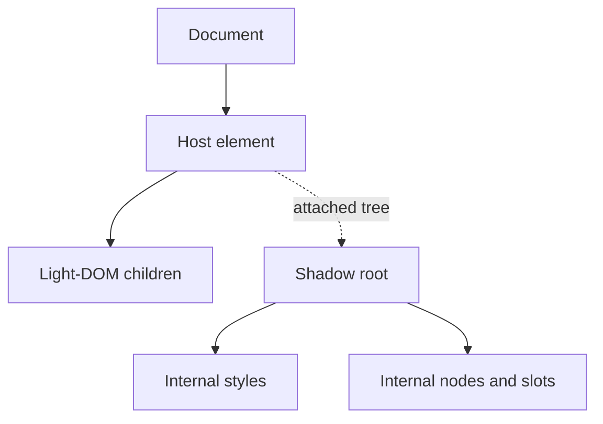

# Shadow DOM

Shadow DOM attaches a separate node tree to a host element. It helps encapsulate a component's markup and styles. It exists in the running page; browser Inspect tools merely display it.

## Host, root and internal nodes



## Try an open shadow tree

```javascript
const host = document.createElement('div');
document.body.append(host);
const root = host.attachShadow({ mode: 'open' });
const message = document.createElement('p');
message.textContent = 'Inside';
root.append(message);
console.log(host.querySelector('p'));
console.log(root.querySelector('p').textContent);
host.remove();
```

Output:

```text
null
Inside
```

## Encapsulation is not security

Closed mode makes `host.shadowRoot` return `null`; it does not make the tree inaccessible to code retaining a root reference, nor protect secrets against hostile scripts. The supplied notes overstate this protection.

Inherited properties and CSS custom properties can cross the boundary. Slots and exposed parts provide intentional customization. Avoid describing shadow styling as absolute isolation.

Use it for reusable UI with deliberate accessibility and styling contracts. It is different from [React reconciliation](/knowledge/react-reconciliation), which concerns how React updates UI. See [Web Components](/knowledge/web-components), [templates and slots](/knowledge/html-templates), and [MDN's shadow DOM guide](https://developer.mozilla.org/en-US/docs/Web/API/Web_components/Using_shadow_DOM).
