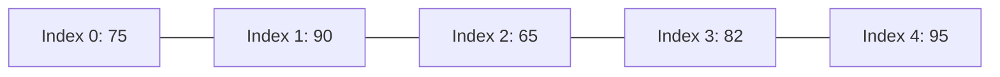
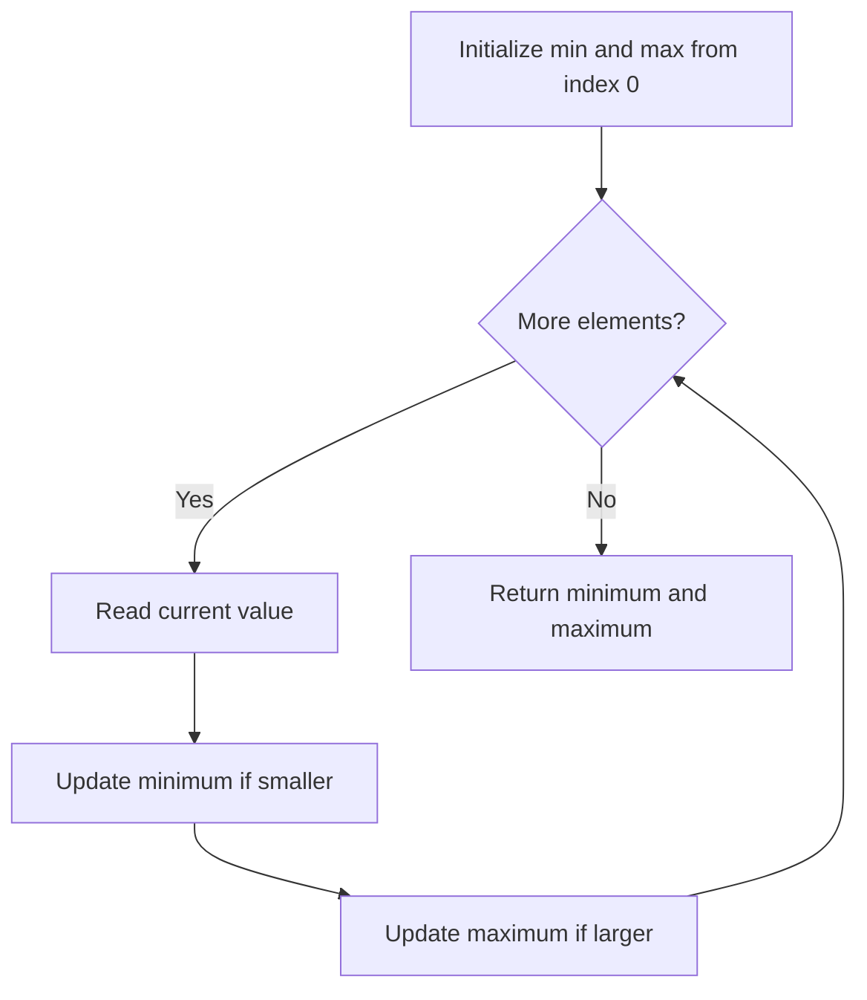
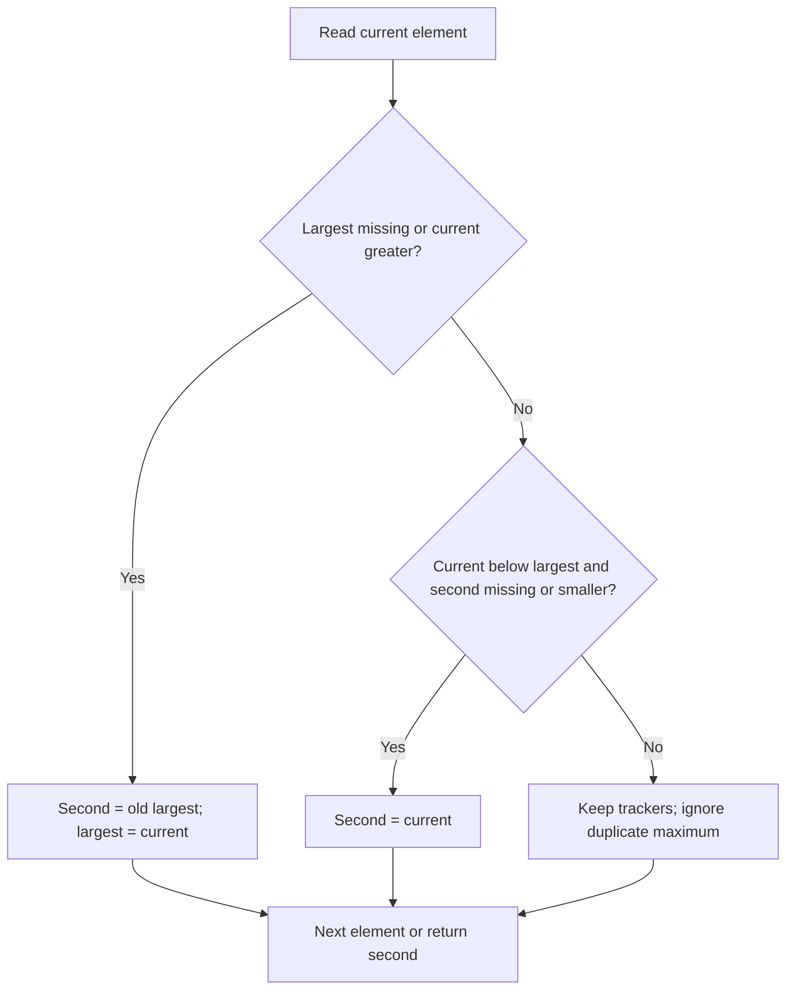
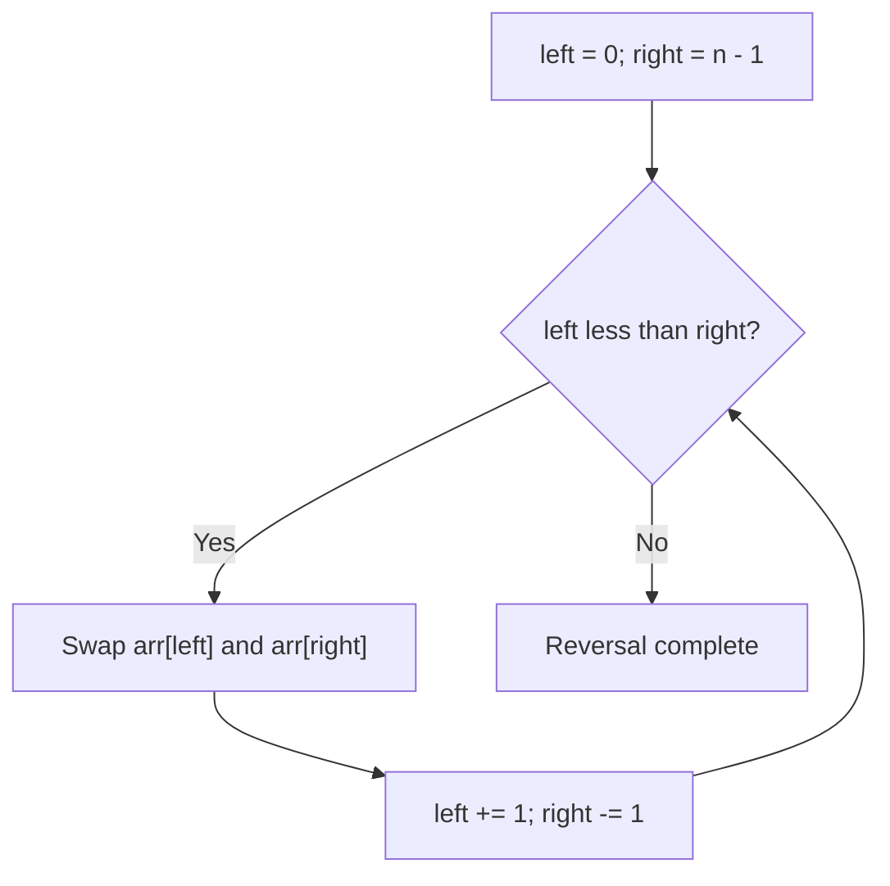

> Conversion note: This file contains the three supplied lessons and the 22-problem roadmap. Missing interactive components were recreated from the source data; their original appearance and code were unavailable. The untouched source is in [source/DSA-original.md](source/DSA-original.md). External preview links at the end are retained as references, not bundled images.

[Interactive demonstrations and quizzes](interactive/index.html) · [Java programs](code/java/) · [Python programs](code/python/) · [Usage and publishing](USAGE.md)

# **Complete DSA Coding Test Preparation Course — Java + Python**

22 Coding Problems

6 Difficulty Levels

Java + Python

**Our objective:** Build your ability to understand a coding problem, identify the appropriate data structure and algorithm, derive a correct solution, optimize it, calculate its complexity, and explain it confidently during a technical interview.

This course will teach algorithms rather than relying on memorized code. We will begin with basic array operations and gradually introduce hashing, two pointers, sliding windows, binary search, stacks, linked lists, recursion, trees, graphs, and dynamic programming.

## **Part 1 — Reordered 22-problem course roadmap**

I have reordered the problems so that each major algorithm builds on concepts introduced earlier. The original problem numbers are preserved.

LEVEL 1 — Beginner: Arrays, Strings & Traversal7 problems · 1–7 of 22

| New # | Old # | Problem / Pattern                                           | Difficulty / Prerequisite                              |
| ----- | ----- | ----------------------------------------------------------- | ------------------------------------------------------ |
| 1     | 1     | **Find largest and smallest**<br>Linear traversal           | Easy<br>Array indices, loops                           |
| 2     | 2     | **Second-largest distinct value**<br>Maintaining two values | Easy<br>Min/max traversal, comparisons                 |
| 3     | 3     | **Reverse an array**<br>Two pointers, swapping              | Easy<br>Array indexing and mutation                    |
| 4     | 4     | **Check a palindrome**<br>Opposite-end pointers             | Easy<br>Two pointers, strings                          |
| 5     | 6     | **Remove duplicates**<br>HashSet / set                      | Easy<br>Loops, hash-set membership                     |
| 6     | 7     | **Count element frequencies**<br>HashMap / dictionary       | Easy<br>Key-value pairs, hashing                       |
| 7     | 5     | **Check anagrams**<br>Frequency counting                    | Easy–Medium<br>Strings, dictionaries, character counts |

LEVEL 2 — Beginner to Intermediate: Hashing & Two Pointers3 problems · 8–10 of 22

LEVEL 3 — Intermediate: Sorting, Searching & Windows4 problems · 11–14 of 22

LEVEL 4 — Intermediate: Linear Data Structures3 problems · 15–17 of 22

LEVEL 5 — Intermediate to Advanced: Trees & Graphs3 problems · 18–20 of 22

LEVEL 6 — Intermediate: Recursion & Dynamic Programming2 problems · 21–22 of 22

### **Why this order?**

The first two problems teach how to scan an array and maintain useful information while processing elements. Array reversal then introduces pointers from opposite ends, which directly prepares you for palindrome checking, merging arrays, and other two-pointer problems.

We will learn sets and maps before Two Sum or advanced substring problems. Sorting comes before binary search, linked-list nodes before linked-list pointers, and stack/queue fundamentals before their applications.

**Prerequisite bridge lessons** will be included at the right moments, without counting toward the 22 problems. These will cover topics such as recursion before tree traversal, queues before BFS, and recursive call trees before dynamic programming.

## **Part 2 — Batch 1: Array traversal and two-pointer foundations**

**Today's lessons**

Batch 1 of 8 planned batches

1. Find the largest and smallest elements — original #1
2. Find the second-largest distinct element — original #2
3. Reverse an array — original #3

These three problems build the core skills of scanning, updating variables, tracking indices, and swapping elements. The exact same reasoning will be used in both languages.

# **Foundation 0 — Essential DSA concepts before coding**

## **0.1 What is a data structure?**

A **data structure** is a way to organize and store data so that we can access, modify, search, or process it efficiently.

For example, suppose you have five marks:

`[75, 90, 65, 82, 95]`

Instead of creating five independent variables, you store them in an array or list. This makes it possible to access elements through indices and process them with a loop.

### **Java arrays versus Python lists**

| Feature             | Java `int[]`                      | Python `list`               |
| ------------------- | --------------------------------- | --------------------------- |
| Example             | `int[] a = {5, 8, 2};`            | `a = [5, 8, 2]`             |
| First index         | `a[0]`                            | `a[0]`                      |
| Length              | `a.length`                        | `len(a)`                    |
| Change an element   | `a[1] = 10;`                      | `a[1] = 10`                 |
| Size                | Fixed length                      | Dynamically resizable       |
| Element storage     | Contiguous primitive `int` values | Array of object references  |
| Mixed element types | Not in a primitive `int[]`        | Allowed                     |
| Negative indexing   | Not supported                     | `a[-1]` is the last element |
| Fast index access   | O(1)                              | O(1)                        |

A Python list is conceptually closer to Java's `ArrayList<Integer>` than to a primitive `int[]`, although there are important implementation and memory differences.

## **0.2 How indices work**

Example: Array of five elements




For an array containing `n` elements:

- First valid index: `0`
- Last valid index: `n - 1`
- Total valid indices: `n`
- Index `n` is out of bounds.

For `n = 5`, valid indices are `0, 1, 2, 3, 4`.

## **0.3 What is an algorithm?**

An algorithm is a finite sequence of well-defined steps that solves a problem.

To find the maximum value in an array, a straightforward algorithm is:

1. Assume the first value is the maximum.
2. Visit each remaining value.
3. Compare it with the maximum stored so far.
4. Replace the maximum whenever a larger value appears.
5. Return the stored maximum.

This is an algorithm, even before we write Java or Python code.

## **0.4 Time complexity and space complexity**

### **Time complexity**

Time complexity describes how the amount of work grows as the input size increases.

Let `n` be the number of array elements.

| Complexity | Example             | Work for n = 1,000 (illustrative)    |
| ---------- | ------------------- | ------------------------------------ |
| O(1)       | Access `a[3]`       | Constant amount                      |
| O(log n)   | Binary search       | About 10 halvings                    |
| O(n)       | Visit every element | About 1,000 visits                   |
| O(n log n) | Merge sort          | About 10,000 proportional operations |
| O(n²)      | Compare every pair  | About 1,000,000 pairs                |

These quantities describe mathematical growth, not exact execution time. Actual CPU instructions, memory accesses, and runtime overhead also matter.

### **Space complexity**

Space complexity describes memory usage. In this course, we will generally report **auxiliary space**, meaning additional working memory beyond the input and required output.

For example:

```python
largest = arr[0]
```

Only one extra variable is required, regardless of `n`, so auxiliary space is O(1).

However:

```python
copy = arr.copy()
```

The new list stores `n` references, so the auxiliary space used by that copy is O(n).

### **Big-O, Big-Omega, and Big-Theta**

- **O(f(n))** gives an asymptotic upper bound.
- **Ω(f(n))** gives an asymptotic lower bound.
- **Θ(f(n))** gives a tight bound.

If an algorithm performs `3n + 5` basic operations, then:

$$
 T(n)=3n+5=\Theta(n) 
$$

We ignore constant factors and lower-order terms when describing asymptotic growth, but those constants can still matter in actual performance.

## **0.5 Java and Python program basics**

Java uses a class and static method in our first examples:

```java
public class Main {
    public static void main(String[] args) {
        int[] arr = {5, 8, 2};

        System.out.println(arr[0]);
    }
}
```

Python does not require a surrounding class:

```python
def main():
    arr = [5, 8, 2]
    print(arr[0])

if __name__ == "__main__":
    main()
```

Both programs output:

```text
5
```

In Java, `static` lets `main` call another static method without creating an instance of `Main`. Python module-level functions can be called directly by name.

For the Java code examples below, save each complete program separately as `Main.java` and run:

```shell
javac Main.java
java Main
```

For Python, save each example separately as `main.py` and run:

```shell
python main.py
```

# **Lesson 1 — Find the largest and smallest elements in an array**

Course #1

Original #1

Beginner

## **A. Problem understanding**

**Problem statement:** Given an array of integers, find its smallest and largest elements.

Example 1:

```text
Input:  [7, -3, 12, 12, 0]

Output:
Smallest = -3
Largest  = 12
```

Example 2:

```text
Input:  [-8, -4, -15, -2]

Output:
Smallest = -15
Largest  = -2
```

Notice that the largest negative number is the number closest to zero, not the one with the largest absolute value.

**Assumptions and constraints:**

- The array may contain positive, negative, zero, and duplicate values.
- Its size can be any nonnegative integer.
- For an empty array, our implementations will raise an error because neither minimum nor maximum is defined.
- We will not modify the original array.
- All Java values fit in the `int` type.

**What an interviewer tests:** Can you traverse an array, initialize variables correctly, compare values, and avoid unnecessary work?

## **B. Prerequisite revision — Array traversal**

Array traversal means visiting elements of an array, usually one after another.

### **Java**

```java
int[] arr = {10, 20, 30};

for (int i = 0; i < arr.length; i++) {
    System.out.println(arr[i]);
}
```

Here:

- `int[]` declares an integer array.
- `i = 0` starts at the first index.
- `i < arr.length` prevents accessing beyond the last element.
- `i++` increments the index by 1.
- `arr[i]` accesses the element at that index.

Java also supports an enhanced for-loop:

```java
for (int value : arr) {
    System.out.println(value);
}
```

This is useful when you need the values but not their indices.

### **Python**

```python
arr = [10, 20, 30]
for i in range(len(arr)):
    print(arr[i])
```

The expression `range(len(arr))` produces indices `0, 1, 2` for this example.

Python also allows direct iteration:

```python
for value in arr:
    print(value)
```

And when both the index and element are necessary:

```python
for i, value in enumerate(arr):
    print(i, value)
```

**Important performance facts:** An indexed read from a Java array or Python list is O(1). Traversing `n` elements is O(n). Appending to a Python list is amortized O(1), but inserting at the beginning is O(n) because existing references must be shifted.

## **C. Pattern recognition — Linear scan**

**Interview clue:** “Find the minimum, maximum, total, average, or count of values in an unsorted array.”

Usually, start by considering a single linear scan.

**Key observation:** You do not need to remember every previously examined element. You only need the smallest and largest values found so far.

This pattern is also useful for finding the highest salary, lowest temperature, maximum score, or count of qualifying transactions.

It is not sufficient when the interviewer asks for more structural information, such as all pairs with a particular relationship, sorted ordering, or every range maximum. Those problems may require additional data structures or patterns.

## **D. Data structure choice**

We use the original array and two variables.

| Operation                            | Java `int[]` | Python `list` |
| ------------------------------------ | ------------ | ------------- |
| Index access                         | O(1)         | O(1)          |
| Assign element                       | O(1)         | O(1)          |
| Full traversal                       | O(n)         | O(n)          |
| Search unsorted data                 | O(n)         | O(n)          |
| Additional minimum/maximum variables | O(1)         | O(1)          |

Why not use a HashMap, HashSet, or another array? Because the task requires only two values, not a collection of historical results.

Arrays give efficient sequential access and good locality. Java primitive arrays store primitive values directly; Python lists store references to objects, so their memory layouts differ.

## **E. Brute-force solution — Check every candidate against every value**

Imagine considering each element as a possible minimum or maximum.

For each candidate:

1. Compare it with every other array value.
2. If nothing is smaller than the candidate, it is a minimum.
3. If nothing is larger than the candidate, it is a maximum.
4. Repeat for every candidate.

This is correct but repeats many comparisons.

### **Brute-force Java implementation**

```java
public class Main {

    public static int[] findMinMaxBrute(int[] arr) {
        if (arr == null || arr.length == 0) {
            throw new IllegalArgumentException(
                "Array must not be empty"
            );
        }

        int minimum = arr[0];
        int maximum = arr[0];

        for (int candidate : arr) {
            boolean isMinimum = true;
            boolean isMaximum = true;

            for (int value : arr) {
                if (value < candidate) {
                    isMinimum = false;
                }

                if (value > candidate) {
                    isMaximum = false;
                }
            }

            if (isMinimum) {
                minimum = candidate;
            }

            if (isMaximum) {
                maximum = candidate;
            }
        }

        return new int[]{minimum, maximum};
    }

    public static void main(String[] args) {
        int[] arr = {7, -3, 12, 12, 0};

        int[] result = findMinMaxBrute(arr);

        System.out.println("Smallest = " + result[0]);
        System.out.println("Largest  = " + result[1]);
    }
}
```

### **Brute-force Python implementation**

```python
def find_min_max_brute(arr):
    if not arr:
        raise ValueError("Array must not be empty")
    minimum = arr[0]
    maximum = arr[0]
    for candidate in arr:
        is_minimum = True
        is_maximum = True
        for value in arr:
            if value < candidate:
                is_minimum = False
            if value > candidate:
                is_maximum = False
        if is_minimum:
            minimum = candidate
        if is_maximum:
            maximum = candidate
    return minimum, maximum

arr = [7, -3, 12, 12, 0]
minimum, maximum = find_min_max_brute(arr)
print("Smallest =", minimum)
print("Largest  =", maximum)
```

Both programs output:

```text
Smallest = -3
Largest  = 12
```

### **Brute-force dry run**

The input contains five values. Every candidate is checked against all five values, including itself.

| Candidate | Smaller value exists? | Larger value exists? | Result after checking candidate |
| --------- | --------------------- | -------------------- | ------------------------------- |
| `7`       | Yes, `-3` and `0`     | Yes, `12`            | Neither                         |
| `-3`      | No                    | Yes                  | Minimum = `-3`                  |
| `12`      | Yes                   | No                   | Maximum = `12`                  |
| `12`      | Yes                   | No                   | Maximum remains `12`            |
| `0`       | Yes                   | Yes                  | Neither                         |

For example, when candidate = `7`, the inner loop compares against `7`, `-3`, `12`, `12`, and `0`. The flags eventually become `false` and `false`, so it cannot be a minimum or maximum.

**Operation count:**

The outer loop runs `n` times.

For each outer iteration, the inner loop runs `n` times.

$$
 n\times n=n^2 
$$

There are two relational checks in each inner iteration:

$$
 C(n)=2n^2 
$$

For `n = 5`:

$$
 2(5^2)=50\text{ relational checks} 
$$

Other work, such as updating flags, is at most proportional to the same quadratic iteration count. Therefore:

- Best-case time: Θ(n²)
- Average-case time: Θ(n²)
- Worst-case time: Θ(n²)
- Auxiliary space: O(1), because only a fixed number of variables is stored.

Even if the elements are all identical, both loops still perform their full iteration counts.

## **F. Optimized solution — Single traversal**

The brute-force solution repeatedly compares candidates with elements that have already been checked.

We can avoid this repetition by remembering our best answers as we scan.

Initialize:

```text
minimum = first element
maximum = first element
```

For every remaining element:

```text
If current < minimum:
    update minimum

If current > maximum:
    update maximum
```

We now visit every element only once.

### **Optimized Java implementation**

```java
public class Main {

    public static int[] findMinMax(int[] arr) {
        if (arr == null || arr.length == 0) {
            throw new IllegalArgumentException(
                "Array must not be empty"
            );
        }

        int minimum = arr[0];
        int maximum = arr[0];

        for (int i = 1; i < arr.length; i++) {
            int current = arr[i];

            if (current < minimum) {
                minimum = current;
            }

            if (current > maximum) {
                maximum = current;
            }
        }

        return new int[]{minimum, maximum};
    }

    public static void main(String[] args) {
        int[] arr = {7, -3, 12, 12, 0};

        int[] result = findMinMax(arr);

        System.out.println("Smallest = " + result[0]);
        System.out.println("Largest  = " + result[1]);
    }
}
```

### **Line-by-line explanation — Java**

| Code                                        | Explanation                                                                                           |
| ------------------------------------------- | ----------------------------------------------------------------------------------------------------- |
| `public class Main`                         | Declares the class containing the program.                                                            |
| `public static int[] findMinMax(int[] arr)` | Creates a callable static method taking an integer array and returning an integer array.              |
| `if (arr == null \|\| arr.length == 0)`   | Rejects a null reference or empty array. Short-circuiting prevents reading `length` if `arr` is null. |
| `throw new IllegalArgumentException(...)`   | Signals that the method received invalid input.                                                       |
| `int minimum = arr[0]`                      | Initializes the smallest known value.                                                                 |
| `int maximum = arr[0]`                      | Initializes the largest known value.                                                                  |
| `int i = 1`                                 | Starts from the second element because index 0 has already been processed.                            |
| `i < arr.length`                            | Continues while `i` is a valid index.                                                                 |
| `i++`                                       | Advances by one position.                                                                             |
| `int current = arr[i]`                      | Reads the current value.                                                                              |
| `if (current < minimum)`                    | Checks whether a new smaller value has appeared.                                                      |
| `minimum = current`                         | Saves the new minimum.                                                                                |
| `if (current > maximum)`                    | Checks whether a new larger value has appeared.                                                       |
| `maximum = current`                         | Saves the new maximum.                                                                                |
| `return new int[]{minimum, maximum}`        | Creates and returns a two-element result array.                                                       |
| `int[] result = findMinMax(arr)`            | Calls the method and stores its result.                                                               |
| `result[0]`, `result[1]`                    | Retrieve the minimum and maximum respectively.                                                        |

Why initialize using `arr[0]` rather than zero?

Suppose:

```text
arr = [-9, -4, -12]
```

If `maximum = 0`, no array value would exceed it, and the algorithm would incorrectly return zero. Initializing from an actual element prevents this mistake.

### **Optimized Python implementation**

```python
def find_min_max(arr):
    if not arr:
        raise ValueError("Array must not be empty")
    minimum = arr[0]
    maximum = arr[0]
    for i in range(1, len(arr)):
        current = arr[i]
        if current < minimum:
            minimum = current
        if current > maximum:
            maximum = current
    return minimum, maximum

arr = [7, -3, 12, 12, 0]
minimum, maximum = find_min_max(arr)
print("Smallest =", minimum)
print("Largest  =", maximum)
```

### **Line-by-line explanation — Python**

| Code                                   | Explanation                                          |
| -------------------------------------- | ---------------------------------------------------- |
| `def find_min_max(arr):`               | Defines a function that accepts a list.              |
| `if not arr:`                          | Checks whether the list is empty or otherwise falsy. |
| `raise ValueError(...)`                | Raises an exception for invalid input.               |
| `minimum = arr[0]`                     | Stores the first element as the initial minimum.     |
| `maximum = arr[0]`                     | Stores the first element as the initial maximum.     |
| `range(1, len(arr))`                   | Produces index values 1 through `len(arr)-1`.        |
| `current = arr[i]`                     | Reads the current element.                           |
| `if current < minimum:`                | Tests for a smaller element.                         |
| `minimum = current`                    | Updates the minimum.                                 |
| `if current > maximum:`                | Tests for a larger element.                          |
| `maximum = current`                    | Updates the maximum.                                 |
| `return minimum, maximum`              | Returns a tuple containing the two values.           |
| `minimum, maximum = find_min_max(arr)` | Unpacks that tuple into two variables.               |
| `print(...)`                           | Displays the results.                                |

In both languages, the comparison logic is identical.

## **G. Mathematical complexity derivation**

The first element initializes two variables. The loop then processes the remaining `n - 1` elements.

For each element:

- One comparison with `minimum`.
- One comparison with `maximum`.
- Zero or one assignment to update those values; a current value cannot be both below the minimum and above the maximum.

Therefore:

$$
 C(n)=2(n-1)=2n-2 
$$

For five elements:

$$
 C(5)=2(4)=8 
$$

For one million elements:

$$
 C(1{,}000{,}000)=1{,}999{,}998 
$$

The number of comparisons grows linearly.

$$
 T(n)=a(n-1)+b=\Theta(n) 
$$

The algorithm uses two main tracking variables, one index, and one current value:

$$
 S(n)=\Theta(1) 
$$

Comparison growth: brute force versus optimized


| n | Brute force: 2n² | Optimized: 2(n−1) |
| --- | --- | --- |
| 1 | 2 | 0 |
| 5 | 50 | 8 |
| 10 | 200 | 18 |
| 20 | 800 | 38 |
| 50 | 5000 | 98 |

Counts include the two relational checks per compared element.

The optimized solution has best-, average-, and worst-case time Θ(n) because it always completes a full pass. Its worst-case optimality follows from the fact that an unseen element might be the smallest or largest, so every input value must be inspected in the general comparison model.

## **H. Detailed optimized dry run — Same for Java and Python**

### Interactive traversal

[Open the step-by-step traversal](interactive/index.html#minmax). Initial state: array `[7, -3, 12, 12, 0]`, index `0`, current/minimum/maximum `7`, processed `1/5`. Use Previous and Next to inspect each state.



Full tracing table:

| Step    | Index | Current | Compare against min/max | Min after | Max after |
| ------- | ----- | ------- | ----------------------- | --------- | --------- |
| Initial | 0     | 7       | Initialize              | 7         | 7         |
| 1       | 1     | -3      | -3 < 7, -3 > 7?         | -3        | 7         |
| 2       | 2     | 12      | 12 < -3?, 12 > 7        | -3        | 12        |
| 3       | 3     | 12      | 12 < -3?, 12 > 12?      | -3        | 12        |
| 4       | 4     | 0       | 0 < -3?, 0 > 12?        | -3        | 12        |

The answers to the comparisons are, respectively: `(true, false)`, `(false, true)`, `(false, false)`, and `(false, false)`.

### **Why the algorithm is correct**

After each iteration, maintain this invariant:

`minimum`** and **`maximum`** are the actual smallest and largest values in the processed prefix of the array.**

It is initially true for the first element. Each new element can only change the minimum if it is smaller, or the maximum if it is larger. Therefore the invariant remains true after every step.

Once every element is processed, the prefix is the entire array, so both answers must be correct.

## **I. Java versus Python**

| Topic             | Java                        | Python                      |
| ----------------- | --------------------------- | --------------------------- |
| Array/list        | `int[]`                     | `list`                      |
| Length            | `arr.length`                | `len(arr)`                  |
| Error             | `IllegalArgumentException`  | `ValueError`                |
| Return values     | `new int[]{min, max}`       | `(min, max)` tuple          |
| Number type       | 32-bit signed `int`         | Arbitrary-precision integer |
| Result extraction | `result[0]` and `result[1]` | Tuple unpacking             |
| Algorithmic time  | Θ(n)                        | Θ(n)                        |
| Auxiliary space   | O(1)                        | O(1)                        |

Python offers built-ins `min(arr)` and `max(arr)`. Java has utilities such as `Arrays.stream(arr).min()` and `.max()`. These are useful in applications, but coding tests often expect you to implement the traversal itself.

## **J. Edge cases**

| Input                       | Expected result          |
| --------------------------- | ------------------------ |
| `[5]`                       | Min 5, max 5             |
| `[4, 4, 4]`                 | Min 4, max 4             |
| `[-10, -3, -7]`             | Min -10, max -3          |
| `[0, 0, 1]`                 | Min 0, max 1             |
| `[9, 2]`                    | Min 2, max 9             |
| `[2, 9]`                    | Min 2, max 9             |
| `[]`                        | Exception                |
| `[2147483647, -2147483648]` | Correct extremes in Java |

No arithmetic is performed on the numbers, so merely having `Integer.MIN_VALUE` or `Integer.MAX_VALUE` does not create an overflow.

## **K. Common interview mistakes**

1. **Starting with zero:** Incorrect when every value is negative or positive in the relevant direction.
2. **Using **`i <= arr.length`**:** The last valid index is `arr.length - 1`.
3. **Forgetting the empty array:** Accessing `arr[0]` fails when the array is empty.
4. **Replacing max/min unconditionally:** Update only after the appropriate comparison.
5. **Confusing average-case and worst-case:** This optimized implementation performs the same number of comparisons in every valid array of a fixed size.
6. **Reporting O(n) auxiliary space:** The input array is not extra working memory created by this algorithm.

## **L. Memory technique**

**Mnemonic: “Assume → Scan → Compare → Update.”**

The reusable template is:

```java
int best = arr[0];

for (int i = 1; i < arr.length; i++) {
    if (arr[i] > best) {
        best = arr[i];
    }
}
```

```python
best = arr[0]
for i in range(1, len(arr)):
    if arr[i] > best:
        best = arr[i]
```

To derive the minimum version, reverse the comparison. To find both, maintain two tracking variables.

## **M. Practice problems — Attempt in both languages**

Practice set 1

**1. Easy**

Find the first index of the minimum and first index of the maximum in an array.

**2. Easy–Medium**

Count how many times the minimum and maximum values occur in an array.

**3. Medium**

Given a rectangular 2D integer matrix, find its minimum and maximum using traversal, without sorting.

Check off a question when you have attempted it. These local checkboxes are not an assessment score; solutions will be evaluated when you submit your code.

For each exercise, provide both Java and Python code, and state time and auxiliary space complexity.

## **N. Knowledge check — No answer key yet**

**Lesson 1 quiz**

[Take the interactive Lesson 1 quiz](interactive/index.html#lesson1-quiz). Initial progress: 0/7 answered.

1\. What is the time complexity of visiting all n array elements exactly once?

A. O(1)

B. O(log n)

C. O(n)

D. O(n²)

2\. Why is initializing maximum to 0 potentially incorrect?

A. Zero is always the smallest integer

B. The input may contain only negative values

C. It changes the array

D. The loop will never execute

3\. What is the final valid index of an array of length 7?

A. 7

B. 6

C. 8

D. 1

4\. What is the auxiliary space complexity of maintaining two integer trackers?

A. O(1)

B. O(n)

C. O(n log n)

D. O(n²)

5\. Which Java property obtains an array's length?

A. arr.size()

B. len(arr)

C. arr.length

D. arr.length()

6\. What does `return minimum, maximum` return in Python?

A. A dictionary

B. A tuple

C. A set

D. Two independently returned objects

7\. For n = 6, how many relational comparisons does our optimized method perform after initialization?

A. 6

B. 10

C. 12

D. 36

Select answers and submit in the interactive quiz for local grading.

## **O. Lesson 1 revision notes**

| Item             | Key fact                                             |
| ---------------- | ---------------------------------------------------- |
| Problem          | Find min/max                                         |
| Pattern          | Linear traversal                                     |
| Data structure   | Array / Python list                                  |
| Brute force      | Θ(n²) time, O(1) auxiliary space                     |
| Optimized        | Θ(n) time, O(1) auxiliary space                      |
| Java template    | `int min = arr[0];` followed by scan and comparisons |
| Python template  | `minimum = arr[0]` followed by scan and comparisons  |
| Important rule   | Initialize from real input data                      |
| Related problems | Second largest, frequency counting, move zeros       |

**Lesson status:** 

Taught · Assessment pending


# **Lesson 2 — Find the second-largest distinct element**

Course #2 · Original #2 · Beginner

This lesson extends the previous algorithm. Instead of tracking only the largest value, we will maintain the **largest and second-largest distinct values**.

## **A. Problem understanding**

Given an unsorted integer array, find the second-largest *distinct* element.

Example 1:

```text
Input:  [4, 9, 1, 9, 7, -2]
Output: 7
```

The largest value is `9`, and the second-largest distinct value is `7`.

Example 2:

```text
Input:  [5, 5, 5]
Output: No second-largest distinct value
```

Although there are three elements, there is only one unique value.

Example 3:

```text
Input:  [-10, -3, -7, -3]
Output: -7
```

Sorted distinct values would be `[-10, -7, -3]`, so the second-largest is `-7`.

**Our contract:** Return Java `null` or Python `None` if no second distinct value exists. A null *array reference* in Java is treated as invalid input.

This problem tests logical conditions, duplicate handling, variable updates, and how to keep track of the top two values efficiently.

## **B. Prerequisite revision — Maintaining multiple trackers**

In Lesson 1, we stored one largest value. Now we store two:

```text
largest = ?
secondLargest = ?
```

Consider the sequence:

`4, 9, 1, 9, 7`

When we read `4`, it is the only known distinct value.

When we read `9`, it becomes the largest, and `4` becomes second-largest.

When we read `1`, nothing changes.

When we read the duplicate `9`, nothing changes.

When we read `7`, it replaces `4` as second-largest.

### **What is a sentinel?**

A sentinel is a special value used to represent a missing or uninitialized result.

An initially unknown second-largest value should not be represented by zero, because zero might be larger than every actual array value.

Java supports a nullable object reference:

```java
Integer secondLargest = null;
```

Python uses:

```python
second_largest = None
```

`Integer` is Java's wrapper class for the primitive `int`. Unlike `int`, a variable of type `Integer` can hold `null`.

For example:

```java
int number = 10;           // Primitive
Integer boxedNumber = 10;  // Wrapper object reference
Integer missing = null;    // Allowed
```

Java can automatically convert between an `int` and an `Integer`, a process called *boxing* and *unboxing*.

**Important:** Unboxing a null `Integer` would cause a `NullPointerException`. We avoid this by checking whether the value is null first.

Python integers are objects, and a variable can refer to either an integer or `None`.

## **C. Pattern recognition**

**Clues:** “Second-largest,” “second-smallest,” “runner-up score,” “top two distinct values,” or “largest two numbers without sorting.”

The pattern is maintaining two running best values.

The critical observation is:

- If a new value exceeds the largest, the previous largest becomes the second-largest.
- If a value lies strictly below the largest but exceeds the second-largest, update only the second-largest.
- If a value equals the largest, ignore it.

This pattern is appropriate when you need a fixed, small number of extremal values. For arbitrary top-k queries, a heap or other structure may be more appropriate. We will cover that distinction when studying additional DSA patterns.

## **D. Data structure explanation**

We still use only the input array and two trackers.

A HashSet could store unique elements, but that would require O(d) additional space for `d` distinct values, plus another operation to determine ranking.

A sorting-based approach could also work, but sorting the entire array is unnecessary when we only need the top two distinct values.

The major Java/Python difference here is representation of the missing result:

| Concept         | Java              | Python             |
| --------------- | ----------------- | ------------------ |
| Largest tracker | `Integer largest` | `largest`          |
| Missing value   | `null`            | `None`             |
| Null check      | `largest == null` | `largest is None`  |
| Array traversal | Enhanced `for`    | `for value in arr` |
| Result type     | `Integer`         | `int` or `None`    |

## **E. Brute-force solution — Two complete passes**

A simple correct method is:

**Pass 1:** Find the maximum.

**Pass 2:** Find the greatest value strictly smaller than that maximum.

We already know how to find the maximum from Lesson 1.

### **Brute-force Java**

```java
public class Main {

    public static Integer secondLargestBrute(int[] arr) {
        if (arr == null) {
            throw new IllegalArgumentException(
                "Array cannot be null"
            );
        }

        if (arr.length < 2) {
            return null;
        }

        // Pass 1: Find the largest
        int largest = arr[0];

        for (int value : arr) {
            if (value > largest) {
                largest = value;
            }
        }

        // Pass 2: Find the second-largest distinct
        Integer secondLargest = null;

        for (int value : arr) {
            if (value < largest &&
                (secondLargest == null ||
                 value > secondLargest)) {

                secondLargest = value;
            }
        }

        return secondLargest;
    }

    public static void main(String[] args) {
        int[] arr = {4, 9, 1, 9, 7, -2};

        Integer answer = secondLargestBrute(arr);

        System.out.println("Second largest = " + answer);
    }
}
```

### **Brute-force Python**

```python
def second_largest_brute(arr):
    if len(arr) < 2:
        return None
    # Pass 1: Find the largest
    largest = arr[0]
    for value in arr:
        if value > largest:
            largest = value
    # Pass 2: Find the second-largest distinct
    second_largest = None
    for value in arr:
        if value < largest and (
            second_largest is None or value > second_largest
        ):
            second_largest = value
    return second_largest

arr = [4, 9, 1, 9, 7, -2]
print("Second largest =", second_largest_brute(arr))
```

Output:

```text
Second largest = 7
```

### **Brute-force execution trace**

Pass 1 — Find maximum

| Step    | Value | Largest before | Largest after |
| ------- | ----- | -------------- | ------------- |
| Initial | 4     | —              | 4             |
| 1       | 4     | 4              | 4             |
| 2       | 9     | 4              | 9             |
| 3       | 1     | 9              | 9             |
| 4       | 9     | 9              | 9             |
| 5       | 7     | 9              | 9             |
| 6       | -2    | 9              | 9             |

Maximum = `9`.

Pass 2 — Find second distinct maximum

| Step | Value | Smaller than 9? | Second-largest after |
| ---- | ----- | --------------- | -------------------- |
| 1    | 4     | Yes             | 4                    |
| 2    | 9     | No              | 4                    |
| 3    | 1     | Yes             | 4                    |
| 4    | 9     | No              | 4                    |
| 5    | 7     | Yes             | 7                    |
| 6    | -2    | Yes             | 7                    |

Notice that the condition `value < largest` excludes every occurrence of the largest number. Without it, a duplicate maximum might incorrectly become the second-largest.

### **Brute-force complexity**

The first traversal runs `n` iterations, and the second traversal runs `n` iterations.

$$
 T(n)=n+n=2n 
$$

If each step performs a bounded number of comparisons and assignments:

$$
 T(n)=\Theta(n) 
$$

Auxiliary memory consists of the `largest`, `secondLargest`, and loop variables:

$$
 S(n)=\Theta(1) 
$$

Best, average, and worst cases are all Θ(n) in this implementation for input sizes of at least two. Inputs of size zero or one return immediately in O(1).

The two-pass method is **already asymptotically optimal**. An improvement does not necessarily have to reduce Big-O complexity; it can reduce passes and constant overhead.

## **F. Optimized solution — Find both in one pass**

We can improve the two-pass algorithm by updating both values while reading each element only once.

There are three cases:

Decision diagram




### **Optimized Java implementation**

```java
public class Main {

    public static Integer secondLargest(int[] arr) {
        if (arr == null) {
            throw new IllegalArgumentException(
                "Array cannot be null"
            );
        }

        Integer largest = null;
        Integer secondLargest = null;

        for (int current : arr) {

            if (largest == null || current > largest) {
                secondLargest = largest;
                largest = current;

            } else if (
                current < largest &&
                (secondLargest == null ||
                 current > secondLargest)
            ) {
                secondLargest = current;
            }
        }

        return secondLargest;
    }

    public static void main(String[] args) {
        int[] arr = {4, 9, 1, 9, 7, -2};

        Integer answer = secondLargest(arr);

        System.out.println("Second largest = " + answer);
    }
}
```

### **Optimized Java — Line-by-line explanation**

| Code                                             | Meaning                                                                  |
| ------------------------------------------------ | ------------------------------------------------------------------------ |
| `public static Integer secondLargest(int[] arr)` | Returns an `Integer` object reference so `null` can represent no result. |
| `if (arr == null)`                               | Rejects a null input array reference.                                    |
| `Integer largest = null`                         | No largest value is known initially.                                     |
| `Integer secondLargest = null`                   | No second-largest distinct value is known initially.                     |
| `for (int current : arr)`                        | Visits each element exactly once.                                        |
| `largest == null`                                | Handles the first encountered element.                                   |
| `current > largest`                              | Checks whether the current value is a new maximum.                       |
| `\|\|`                                         | Logical OR; skips the second condition when the first is true.           |
| `secondLargest = largest`                        | Demotes the previous maximum to runner-up.                               |
| `largest = current`                              | Promotes the current value to maximum.                                   |
| `else if`                                        | Runs only when the first condition is false.                             |
| `current < largest`                              | Excludes duplicate maximum values.                                       |
| `secondLargest == null`                          | Allows the first valid runner-up to be stored.                           |
| `current > secondLargest`                        | Determines whether the runner-up should improve.                         |
| `secondLargest = current`                        | Updates the second-largest distinct value.                               |
| `return secondLargest`                           | Returns an integer or null.                                              |

Notice the assignment order:

```java
secondLargest = largest;
largest = current;
```

This is important. We must save the previous maximum before replacing it.

### **Optimized Python implementation**

```python
def second_largest(arr):
    largest = None
    second_largest_value = None
    for current in arr:
        if largest is None or current > largest:
            second_largest_value = largest
            largest = current
        elif current < largest and (
            second_largest_value is None
            or current > second_largest_value
        ):
            second_largest_value = current
    return second_largest_value

arr = [4, 9, 1, 9, 7, -2]
answer = second_largest(arr)
print("Second largest =", answer)
```

### **Optimized Python — Line-by-line explanation**

| Code                                | Meaning                                             |
| ----------------------------------- | --------------------------------------------------- |
| `def second_largest(arr):`          | Defines the function.                               |
| `largest = None`                    | No maximum has been seen.                           |
| `second_largest_value = None`       | No second distinct maximum has been seen.           |
| `for current in arr:`               | Iterates over all array values.                     |
| `largest is None`                   | Checks for missing initial maximum using identity.  |
| `or current > largest`              | Detects a new largest value.                        |
| `second_largest_value = largest`    | Preserves the previous maximum as runner-up.        |
| `largest = current`                 | Updates the maximum.                                |
| `elif current < largest`            | Ensures the candidate is distinct from the maximum. |
| `second_largest_value is None`      | Detects an uninitialized runner-up.                 |
| `or current > second_largest_value` | Detects a better runner-up.                         |
| `second_largest_value = current`    | Stores the updated runner-up.                       |
| `return second_largest_value`       | Returns the result or `None`.                       |

Python's `is None` is the preferred way to test for the `None` singleton.

Both implementations use short-circuit logical operators. This is essential: the code does not compare a number with a missing value.

## **G. Mathematical analysis**

Let `n` be the number of elements.

The optimized loop executes `n` times.

Each iteration performs only a constant number of comparisons and assignments, with no nested traversal.

For some fixed constants `c` and `d`:

$$
 T(n)=cn+d 
$$

Therefore:

$$
 T(n)=\Theta(n) 
$$

The number of extra variables is constant:

$$
 S(n)=\Theta(1) 
$$

| Case            | Time | Explanation                                       |
| --------------- | ---- | ------------------------------------------------- |
| Best            | Θ(n) | All `n` values are still scanned                  |
| Average         | Θ(n) | Constant work per value                           |
| Worst           | Θ(n) | Even continual tracker updates take constant work |
| Auxiliary space | O(1) | Only two value trackers                           |

For an empty input, the optimized method returns `null` or `None` in O(1).

Why can't we guarantee a better-than-linear search for an arbitrary unsorted array? Because a value at the last unchecked position could alter the maximum or runner-up.

Both methods have optimal asymptotic time, but the optimized one uses a single pass instead of two.

## **H. Detailed dry run — Both languages**

Input:

`[4, 9, 1, 9, 7, -2]`

| Step  | Current | Condition / action          | Largest     | Second-largest |
| ----- | ------- | --------------------------- | ----------- | -------------- |
| Start | —       | Initialize                  | null / None | null / None    |
| 1     | 4       | First value becomes largest | 4           | null / None    |
| 2     | 9       | 9 > 4: demote 4             | 9           | 4              |
| 3     | 1       | 1 < 9 but 1 < 4: skip       | 9           | 4              |
| 4     | 9       | Duplicate maximum: skip     | 9           | 4              |
| 5     | 7       | 7 < 9 and 7 > 4: update     | 9           | 7              |
| 6     | -2      | Smaller than both: skip     | 9           | 7              |

Final output: `7`.

The Java and Python code follows exactly the same comparisons and updates.

### **Proof of correctness**

After every processed element, the two variables maintain this invariant:

- `largest` is the greatest value seen so far.
- `secondLargest` is the greatest distinct value smaller than `largest`, or missing if no such value exists.

There are only three meaningful possibilities when processing a new value: it is greater than the largest, it is a valid new runner-up, or it changes nothing. The algorithm handles all three, so the invariant is preserved.

At the end of the scan, the invariant applies to the entire array.

## **I. Java versus Python comparison**

| Factor           | Java                        | Python                  |
| ---------------- | --------------------------- | ----------------------- |
| Missing result   | `null`                      | `None`                  |
| Tracker type     | `Integer`                   | Dynamic variable        |
| Unboxing         | May occur during comparison | Not applicable          |
| Null check       | `== null`                   | `is None`               |
| Loop syntax      | `for (int current : arr)`   | `for current in arr`    |
| Integer limits   | `int` has fixed bounds      | Integers grow as needed |
| Time             | Θ(n)                        | Θ(n)                    |
| Auxiliary memory | O(1)                        | O(1)                    |

Java's wrapper objects can introduce some allocation or boxing overhead. Python's integer objects and list references also introduce runtime and memory overhead. Those factors do not change the algorithm's Big-O complexity.

## **J. Edge cases**

| Input              | Java output   | Python output |
| ------------------ | ------------- | ------------- |
| `[10, 20]`         | `10`          | `10`          |
| `[20, 10]`         | `10`          | `10`          |
| `[5, 5]`           | `null`        | `None`        |
| `[5]`              | `null`        | `None`        |
| `[]`               | `null`        | `None`        |
| `[-8, -2, -5]`     | `-5`          | `-5`          |
| `[9, 9, 7, 7, 6]`  | `7`           | `7`           |
| `[0, 0, -1]`       | `-1`          | `-1`          |
| `[-2147483648, 0]` | `-2147483648` | `-2147483648` |

Using `null` and `None` avoids the incorrect assumption that a minimum integer sentinel is always safe. For example, `Integer.MIN_VALUE` itself may legitimately be the second-largest distinct value.

## **K. Common mistakes and MCQ traps**

**Mistake 1 — Treating duplicates as separate ranks.**

For `[10, 10, 8]`, the second-largest distinct value is `8`, not `10`.

**Mistake 2 — Incorrect initialization.**

```java
int secondLargest = 0;
```

This breaks all-negative cases.

**Mistake 3 — Losing the previous maximum.**

```java
largest = current;
secondLargest = largest;
```

This assigns the new maximum to both trackers, which is incorrect.

**Mistake 4 — Incorrect complexity claims.**

Two passes over `n` elements require O(2n) work, which simplifies to O(n), not O(n²).

**Mistake 5 — Java wrapper comparison.**

Do not compare two arbitrary `Integer` objects with `==` when testing numeric equality, because that can compare object references. The comparison in our code uses `int` values and numeric unboxing.

**Mistake 6 — Python truthiness.**

Do not use `if not second_largest_value:` to check for a missing result. The value `0` is valid but falsy. Use `is None`.

## **L. Memory technique**

**Mnemonic: “New champion → demote old champion; better runner-up → promote runner-up.”**

Reusable core template:

Java:

```java
if (largest == null || x > largest) {
    second = largest;
    largest = x;
} else if (x < largest &&
           (second == null || x > second)) {
    second = x;
}
```

Python:

```python
if largest is None or x > largest:
    second = largest
    largest = x
elif x < largest and (
    second is None or x > second
):
    second = x
```

These snippets belong inside a traversal, with `largest` and `second` initialized to missing values.

## **M. Practice problems**

Complete these in **both Java and Python**, without sorting unless specified.

1. **Easy:** Find the second-smallest distinct value in an array.
2. **Medium:** Find the third-largest distinct value using a constant number of tracking variables.
3. **Medium–Hard:** Given `k`, find the k-th largest distinct element. Compare a sorting-based solution with any more efficient method you know.

For all three, define what happens if fewer than the required number of distinct elements exist.

## **N. Knowledge check**

Answer these seven questions without executing the code.

1. For `[9, 9, 7, 5]`, what is the second-largest distinct value?
2. Why does our optimized algorithm use `current < largest` instead of `current <= largest`?
3. If we process `[3, 8, 6]`, what are `largest` and `secondLargest` after the final iteration?
4. Does changing the algorithm from two passes to one pass change its Big-O time complexity? Explain.
5. Why is `Integer.MIN_VALUE` an unsafe universal marker for “no second-largest value”?
6. What happens if Java tries to unbox a null `Integer` during a numeric comparison?
7. Why must Python use `is None` instead of a general truthiness test for an optional numeric tracker?

Do not look up the code to answer. Try reconstructing the update rules yourself.

## **O. Lesson 2 revision notes**

| Item                | Key fact                                 |
| ------------------- | ---------------------------------------- |
| Problem             | Second-largest distinct                  |
| Pattern             | Running top-two tracking                 |
| Data structure      | Array + two optional trackers            |
| Brute force         | Θ(n) time, O(1) space; two passes        |
| Optimized           | Θ(n) time, O(1) space; one pass          |
| Java template       | `Integer largest = null, second = null;` |
| Python template     | `largest = second = None`                |
| Most important rule | Duplicates do not create a new rank      |
| Related problems    | Third-largest, k-th largest, top-k       |

**Lesson status:** Taught; practice and knowledge assessment pending.

# **Lesson 3 — Reverse an array using two pointers**

Course #3 · Original #3 · Beginner

This lesson introduces one of the most important coding interview patterns: **two pointers**.

The previous two problems required reading array elements and maintaining variables. Now we will modify an array by manipulating two indices.

## **A. Problem understanding**

Given an array of integers, reverse the order of its elements.

Example 1:

```text
Input:  [3, 8, -1, 0, 5]
Output: [5, 0, -1, 8, 3]
```

Example 2:

```text
Input:  [10, 20, 30, 40]
Output: [40, 30, 20, 10]
```

Important distinction: Reversing an array means changing the order of elements, not sorting them in descending order.

For example:

```text
Original:          [3, 9, 1, 7]
Reversed:          [7, 1, 9, 3]
Descending sorted: [9, 7, 3, 1]
```

These are different operations.

The interviewer may ask for either:

- A reversed copy, where the original array remains unchanged.
- **In-place reversal**, where the original array is modified using O(1) extra memory.

We will implement both approaches.

## **B. Prerequisite revision — Indices, swapping, and mutability**

### **What is swapping?**

Swapping means exchanging the values stored in two locations.

Suppose:

```text
a = 10
b = 20
```

After swapping:

```text
a = 20
b = 10
```

### **Java swapping**

```java
int a = 10;
int b = 20;

int temp = a;
a = b;
b = temp;
```

Why do we need `temp`?

If we write:

```java
a = b;
b = a;
```

Both variables become `20`, because the original `a` is overwritten before it can be assigned to `b`.

### **Python swapping**

Python supports tuple assignment:

```text
a = 10b = 20a, b = b, a
```

Python evaluates the right-hand side before assigning the resulting values to the destinations, preserving the original values needed for the swap.

### **What are two pointers?**

Two pointers are two variables used to keep track of positions within a data structure.

For array reversal:

- `left` starts at index `0`.
- `right` starts at index `n - 1`.
- We swap their elements.
- `left` moves right.
- `right` moves left.

Two-pointer movement

The word *pointer* here means an index variable. Neither Java nor Python uses direct C-style memory pointers in this implementation.

### **Java and Python mutability**

A Java array is mutable:

```java
int[] arr = {1, 2, 3};
arr[0] = 9;
```

A Python list is also mutable:

```text
arr = [1, 2, 3]arr[0] = 9
```

Both now contain `[9, 2, 3]`.

However, Python tuples and strings are immutable. We cannot directly swap their elements in place.

## **C. Pattern recognition**

Look for interview phrases such as:

- “Reverse in place.”
- “Use constant extra space.”
- “Swap the first and last elements.”
- “Process the array from both ends.”
- “Reverse a subarray.”

These are clues for the **opposite-end two-pointer pattern**.

The pattern is useful when the problem has a relationship between the left and right ends of a sequence. It will reappear in palindrome checking and other array problems.

It is not always the best pattern. For example, a running sum generally needs only one traversal variable. A problem requiring preservation of the original array may need a new output buffer.

## **D. Data structure explanation**

| Operation              | Java array            | Python list           |
| ---------------------- | --------------------- | --------------------- |
| Read left element      | `arr[left]`           | `arr[left]`           |
| Read right element     | `arr[right]`          | `arr[right]`          |
| Change a position      | O(1)                  | O(1)                  |
| Swap two positions     | O(1)                  | O(1)                  |
| Create a reversed copy | O(n) memory           | O(n) memory           |
| Reverse in place       | O(1) auxiliary memory | O(1) auxiliary memory |

Java arrays have fixed length. Python lists can grow or shrink, but our reversal algorithm does not change their length.

In both languages, if two variables refer to the same array or list, an in-place reversal through one reference will be visible through the other reference.

## **E. Brute-force solution — Create a reversed copy**

The simplest approach is to create another array of the same size.

For input size `n`, the reversed element at index `i` comes from original index:

$$
 n-1-i 
$$

For an array of five elements:

| New index `i` | Original index `n-1-i` |
| ------------- | ---------------------- |
| 0             | 4                      |
| 1             | 3                      |
| 2             | 2                      |
| 3             | 1                      |
| 4             | 0                      |

### **Brute-force Java implementation**

```java
import java.util.Arrays;

public class Main {

    public static int[] reversedCopy(int[] arr) {
        if (arr == null) {
            throw new IllegalArgumentException(
                "Array cannot be null"
            );
        }

        int n = arr.length;

        int[] reversed = new int[n];

        for (int i = 0; i < n; i++) {
            reversed[i] = arr[n - 1 - i];
        }

        return reversed;
    }

    public static void main(String[] args) {
        int[] arr = {3, 8, -1, 0, 5};

        int[] result = reversedCopy(arr);

        System.out.println(
            "Original: " + Arrays.toString(arr)
        );

        System.out.println(
            "Reversed: " + Arrays.toString(result)
        );
    }
}
```

Output:

```text
Original: [3, 8, -1, 0, 5]
Reversed: [5, 0, -1, 8, 3]
```

Here `Arrays.toString()` converts the array elements into a readable string. Printing an `int[]` directly would display a type-and-identity representation rather than its contents.

### **Brute-force Python implementation**

```python
def reversed_copy(arr):
    n = len(arr)
    reversed_arr = [0] * n
    for i in range(n):
        reversed_arr[i] = arr[n - 1 - i]
    return reversed_arr

arr = [3, 8, -1, 0, 5]
result = reversed_copy(arr)
print("Original:", arr)
print("Reversed:", result)
```

Output:

```text
Original: [3, 8, -1, 0, 5]
Reversed: [5, 0, -1, 8, 3]
```

`[0] * n` creates a list containing `n` zero values. We subsequently replace each value with its corresponding reversed element.

### **Brute-force dry run — Both languages**

Input = `[3, 8, -1, 0, 5]`

Initially:

`reversed = [?, ?, ?, ?, ?]`

| Iteration | `i` | `n - 1 - i` | Value copied | Reversed array after assignment |
| --------- | --- | ----------- | ------------ | ------------------------------- |
| 1         | 0   | 4           | 5            | `[5, ?, ?, ?, ?]`               |
| 2         | 1   | 3           | 0            | `[5, 0, ?, ?, ?]`               |
| 3         | 2   | 2           | -1           | `[5, 0, -1, ?, ?]`              |
| 4         | 3   | 1           | 8            | `[5, 0, -1, 8, ?]`              |
| 5         | 4   | 0           | 3            | `[5, 0, -1, 8, 3]`              |

The placeholders in the table represent positions not yet filled with their final values. In the actual Java array and Python list, those positions initially contain zeros.

### **Complexity calculation**

The loop performs `n` iterations, one source read and one destination write per iteration.

$$
 T(n)=cn+d=\Theta(n) 
$$

The new array stores `n` values.

$$
 M(n)=\Theta(n) 
$$

This is O(n) additional allocated memory relative to the original input. Under a convention that excludes the required output buffer from *auxiliary* space, its auxiliary space is O(1); however, total extra allocated memory is still O(n).

Best, average, and worst-case times are all Θ(n) because every element is copied.

This approach is not inherently a bad algorithm. It is preferable when the input must remain unchanged. We call it the baseline or brute-force solution here because it does not meet an in-place requirement.

## **F. Optimized solution — Swap from both ends**

We can reverse the array without allocating another array.

Algorithm:

1. Start `left = 0`.
2. Start `right = n - 1`.
3. While `left < right`, exchange `arr[left]` and `arr[right]`.
4. Increase `left`.
5. Decrease `right`.
6. Stop when the pointers meet or cross.

### **Optimized Java implementation**

```java
import java.util.Arrays;

public class Main {

    public static void reverseInPlace(int[] arr) {
        if (arr == null) {
            throw new IllegalArgumentException(
                "Array cannot be null"
            );
        }

        int left = 0;
        int right = arr.length - 1;

        while (left < right) {

            int temp = arr[left];

            arr[left] = arr[right];

            arr[right] = temp;

            left++;
            right--;
        }
    }

    public static void main(String[] args) {
        int[] arr = {3, 8, -1, 0, 5};

        System.out.println(
            "Before: " + Arrays.toString(arr)
        );

        reverseInPlace(arr);

        System.out.println(
            "After:  " + Arrays.toString(arr)
        );
    }
}
```

Output:

```text
Before: [3, 8, -1, 0, 5]
After:  [5, 0, -1, 8, 3]
```

### **Java line-by-line explanation**

| Code                                           | Explanation                                                           |
| ---------------------------------------------- | --------------------------------------------------------------------- |
| `import java.util.Arrays;`                     | Provides the `Arrays.toString()` formatting utility.                  |
| `public class Main`                            | Declares our program class.                                           |
| `public static void reverseInPlace(int[] arr)` | Declares a static method that modifies an array and returns no value. |
| `if (arr == null)`                             | Rejects an invalid null array reference.                              |
| `int left = 0`                                 | Starts the first pointer at the beginning.                            |
| `int right = arr.length - 1`                   | Starts the second pointer at the last valid index.                    |
| `while (left < right)`                         | Continues until the two pointers meet or cross.                       |
| `int temp = arr[left]`                         | Temporarily saves the left element.                                   |
| `arr[left] = arr[right]`                       | Copies the right element into the left position.                      |
| `arr[right] = temp`                            | Places the original left element at the right position.               |
| `left++`                                       | Moves the left pointer inward.                                        |
| `right--`                                      | Moves the right pointer inward.                                       |
| `reverseInPlace(arr)`                          | Calls the method and mutates the original array.                      |

**Why is the return type **`void`**?**

Because this method modifies the array passed to it. It does not need to construct and return a new array.

Java passes the value of the array reference to the method. This lets the method modify the same array object that the caller sees, although reassigning the local reference would not reassign the caller's variable.

### **Optimized Python implementation**

```python
def reverse_in_place(arr):
    left = 0
    right = len(arr) - 1
    while left < right:
        arr[left], arr[right] = arr[right], arr[left]
        left += 1
        right -= 1

arr = [3, 8, -1, 0, 5]
print("Before:", arr)
reverse_in_place(arr)
print("After: ", arr)
```

Output:

```text
Before: [3, 8, -1, 0, 5]
After:  [5, 0, -1, 8, 3]
```

### **Python line-by-line explanation**

| Code                                            | Explanation                                                   |
| ----------------------------------------------- | ------------------------------------------------------------- |
| `def reverse_in_place(arr):`                    | Defines the function accepting a mutable list.                |
| `left = 0`                                      | Initializes the left index.                                   |
| `right = len(arr) - 1`                          | Initializes the final index.                                  |
| `while left < right:`                           | Repeats while two different positions still require swapping. |
| `arr[left], arr[right] = arr[right], arr[left]` | Exchanges the two list elements.                              |
| `left += 1`                                     | Moves the left index one step right.                          |
| `right -= 1`                                    | Moves the right index one step left.                          |
| `reverse_in_place(arr)`                         | Calls the function, modifying the same list.                  |

The function implicitly returns `None`.

### **Important Java versus Python observation**

Java uses a temporary variable explicitly:

```java
int temp = arr[left];
arr[left] = arr[right];
arr[right] = temp;
```

Python can use a single assignment:

```python
arr[left], arr[right] = arr[right], arr[left]
```

The algorithm remains the same: read both values and exchange them. Python's concise syntax does not change the Θ(1) cost of an individual swap.

## **G. Mathematical and algorithmic calculations**

We swap two elements during each iteration.

If the array has an even number of elements, every element participates in exactly one swap.

If it has an odd number of elements, the middle element stays in its original position.

The number of swaps is:

$$
 \text{Swaps}(n)=\left\lfloor\frac n2\right\rfloor 
$$

Examples:

| Array length | Number of swaps |
| ------------ | --------------- |
| 0            | 0               |
| 1            | 0               |
| 2            | 1               |
| 5            | 2               |
| 6            | 3               |
| 10           | 5               |
| 101          | 50              |

Each swap uses a constant number of operations.

In Java, the swap itself uses three assignments. The two pointer updates add two more operations.

Ignoring loop-control overhead:

$$
 T(n)\approx 5\left\lfloor\frac n2\right\rfloor 
$$

Therefore, for sufficiently large `n`:

$$
 T(n)=\Theta(n) 
$$

The Java method stores three principal working integers: `left`, `right`, and `temp`.

The Python version stores the two indices and uses constant-sized temporary references during assignment.

Consequently:

$$
 S(n)=\Theta(1) 
$$

For arrays with `n ≥ 2`, the best, average, and worst-case running time is Θ(n). For arrays containing zero or one element, the algorithm completes in O(1).

### **Why stop at **`left < right`**?**

If `left == right`, both indices refer to the same middle element. Swapping it with itself is unnecessary.

If `left > right`, the two sides have already been processed.

Using `left <= right` would perform an unnecessary self-swap on odd-length arrays, although it would still produce the correct answer.

## **H. Complete dry run — Both optimized implementations**

Consider:

`arr = [3, 8, -1, 0, 5]`

### Two-pointer swap simulator

[Open the swap simulator](interactive/index.html#reverse). Initial array: `[3, 8, -1, 0, 5]`; left `0`, right `4`, swap `0/2`. Previous and Next step through both swaps.



### **Swap 1**

Initial:

```text
Index:   0   1   2   3   4
Array:  [3,  8, -1,  0,  5]
         L               R
```

Pointer values:

```text
left  = 0
right = 4
```

Java performs:

```text
temp = arr[0]       = 3
arr[0] = arr[4]     = 5
arr[4] = temp       = 3
```

Python performs the same swap with its multiple-assignment syntax.

After swap 1:

```text
[5, 8, -1, 0, 3]
```

Then:

```text
left  = 1
right = 3
```

### **Swap 2**

Current:

```text
Index:   0   1   2   3   4
Array:  [5,  8, -1,  0,  3]
             L       R
```

Exchange elements at indices 1 and 3:

```text
temp = 8
arr[1] = 0
arr[3] = 8
```

Result:

```text
[5, 0, -1, 8, 3]
```

Then:

```text
left  = 2
right = 2
```

The condition `left < right` is now false.

### **Final tracing table**

| Iteration | Left | Right | Elements swapped | Array afterward    |
| --------- | ---- | ----- | ---------------- | ------------------ |
| Initial   | 0    | 4     | None             | `[3, 8, -1, 0, 5]` |
| 1         | 0    | 4     | 3 and 5          | `[5, 8, -1, 0, 3]` |
| 2         | 1    | 3     | 8 and 0          | `[5, 0, -1, 8, 3]` |
| Stop      | 2    | 2     | None             | `[5, 0, -1, 8, 3]` |

The middle value `-1` remains where it was, which is correct for an odd-length array.

### **Why the optimized algorithm is correct**

The key invariant is:

**Before each swap, the portions outside **`left`** and **`right`** already contain their correct values in the reversed array.**

Initially, no positions have been processed. Swapping the two ends puts both values into their final reversed positions. The pointers then move inward, leaving those positions untouched.

By repeating this operation, we put two more positions into their final locations during each iteration. When the pointers meet or cross, every position is correct.

## **I. Java versus Python comparison**

| Feature                    | Java                              | Python                    |
| -------------------------- | --------------------------------- | ------------------------- |
| Mutable input              | `int[]`                           | `list`                    |
| Last index                 | `arr.length - 1`                  | `len(arr) - 1`            |
| Swapping                   | Temporary variable                | Multiple assignment       |
| Pointer movement           | `left++`, `right--`               | `left += 1`, `right -= 1` |
| Return for in-place method | `void`                            | Implicit `None`           |
| Built-in reverse option    | `Collections.reverse()` for lists | `arr.reverse()` for lists |
| Slicing reversed copy      | Not available directly on arrays  | `arr[::-1]`               |
| Time complexity            | Θ(n)                              | Θ(n)                      |
| Extra memory               | O(1)                              | O(1)                      |

Python's `arr[::-1]` creates a new list and requires O(n) additional memory. `arr.reverse()` modifies the list in place.

In Java, `Collections.reverse()` works with a `List`, not directly with primitive `int[]`. You can reverse a Java `ArrayList<Integer>` using it, but for an `int[]`, the two-pointer method shown above is straightforward.

## **J. Edge cases**

| Input                       | Expected reversed output    |
| --------------------------- | --------------------------- |
| `[]`                        | `[]`                        |
| `[5]`                       | `[5]`                       |
| `[1, 2]`                    | `[2, 1]`                    |
| `[1, 2, 3]`                 | `[3, 2, 1]`                 |
| `[7, 7, 7]`                 | `[7, 7, 7]`                 |
| `[-1, 0, 5]`                | `[5, 0, -1]`                |
| `[4, 3, 2, 1]`              | `[1, 2, 3, 4]`              |
| `[2147483647, -2147483648]` | `[-2147483648, 2147483647]` |

Neither implementation performs arithmetic on the element values themselves. Therefore integer overflow is not a concern for reversing ordinary `int` array elements.

## **K. Common mistakes and interview traps**

**1. Initializing **`right = arr.length`**.**

This is invalid for nonempty arrays because the last index is `arr.length - 1`.

**2. Moving both pointers in the same direction.**

For opposite-end reversal:

```text
left  moves right (+1)
right moves left  (-1)
```

If both indices increase, they will not converge correctly.

**3. Forgetting the temporary variable in Java.**

Overwriting one value before saving it destroys information needed for the swap.

**4. Assuming in-place and copied reversal have the same memory cost.**

Both require Θ(n) time, but the new-copy approach allocates Θ(n) memory while the in-place method uses Θ(1) auxiliary memory.

**5. Confusing references and copies.**

In Python:

```python
a = [1, 2, 3]
b = a
```

Both variables refer to the same list. Reversing `b` in place also changes what you observe through `a`.

Similarly, a Java variable assigned another array reference does not automatically create a copy of the array.

**6. Using Python slicing without checking the requirement.**

`arr[::-1]` is concise and correct for creating a reversed copy, but it does not satisfy an O(1)-extra-space in-place reversal requirement.

## **L. Memory technique**

**Mnemonic: “Swap ends → Move inward → Stop at center.”**

The reusable two-pointer template is:

Java:

```java
int left = 0;
int right = arr.length - 1;

while (left < right) {
    // Process arr[left] and arr[right]

    left++;
    right--;
}
```

Python:

```python
left = 0
right = len(arr) - 1
while left < right:
    # Process arr[left] and arr[right]
    left += 1
    right -= 1
```

The processing step changes depending on the problem.

For reversal, swap the elements.

For palindrome checking, compare the elements.

This is why we study array reversal immediately before palindrome checking.

## **M. Practice problems**

Attempt each question in both languages.

1. **Easy — Reverse a subarray:** Given an array and two valid indices `left` and `right`, reverse only the elements between those indices, inclusive, without modifying the other elements.
2. **Medium — Reverse characters:** Given a mutable sequence of characters, reverse it in place. Consider differences between Java's character arrays and Python's lists of characters.
3. **Medium–Hard — Rotate right by k:** Given an array of length `n` and a nonnegative integer `k`, rotate it right by `k` positions using O(1) auxiliary memory. For example, input `[1,2,3,4,5]` and `k=2` should produce `[4,5,1,2,3]`.

Do not use built-in reversal methods for the first attempt. Trace your pointer movements manually.

## **N. Knowledge check**

Answer without running code.

1. What are the initial `left` and `right` values for an array of length 8?
2. How many swaps are required to reverse an array of length 9?
3. Why does the two-pointer reversal stop when `left >= right`?
4. What happens if you write `arr[left] = arr[right]` followed immediately by `arr[right] = arr[left]` without preserving the original left value?
5. What is the extra memory complexity of an in-place reversal?
6. Is `arr[::-1]` in Python an in-place operation? Explain.
7. If `a` and `b` refer to the same mutable array/list and you reverse through `b`, what happens to the elements visible through `a`?
8. What is the result of reversing `[2, 5, 7, 9, 1, 4]` after exactly two swaps of the two-pointer algorithm?

## **O. Lesson 3 revision notes**

| Item               | Key fact                                     |
| ------------------ | -------------------------------------------- |
| Problem            | Reverse an array                             |
| Pattern            | Opposite-end two pointers                    |
| Data structure     | Mutable array / list                         |
| Baseline solution  | Θ(n) time, O(n) extra allocated memory       |
| Optimized solution | Θ(n) time, O(1) auxiliary space              |
| Number of swaps    | `floor(n / 2)`                               |
| Java template      | `while (left < right)` with `temp` swap      |
| Python template    | `while left < right` with tuple assignment   |
| Important rule     | Move pointers inward after every swap        |
| Related problems   | Palindrome, reverse subarray, array rotation |

**Lesson status:** Taught; practice and knowledge assessment pending.

# **Part 3 — Batch 1 overall comparison**

Before moving to the next batch, compare the three techniques side by side.

| Problem                    | Main idea                            | Baseline time    | Optimized time | Optimized auxiliary space |
| -------------------------- | ------------------------------------ | ---------------- | -------------- | ------------------------- |
| #1 Minimum/maximum         | Maintain two extremes                | Θ(n²)            | Θ(n)           | O(1)                      |
| #2 Second-largest distinct | Maintain the top two distinct values | Θ(n), two passes | Θ(n), one pass | O(1)                      |
| #3 Reverse array           | Swap opposite positions              | Θ(n)             | Θ(n)           | O(1)                      |

Notice that optimization does not always mean obtaining a smaller Big-O time complexity.

In Lesson 1, we eliminated repeated comparisons and reduced Θ(n²) to Θ(n).

In Lesson 2, we reduced two traversals to one, but both remained Θ(n).

In Lesson 3, we reduced additional memory use from O(n) to O(1), while keeping the same Θ(n) time complexity.

These are three different types of algorithmic improvement.

## **Batch 1 mixed assessment**

Answer the following questions without looking at the implementations. The answer key is intentionally withheld.

**Batch 1 MCQ test**

[Take the interactive batch quiz](interactive/index.html#batch-quiz). Initial progress: 0/6 answered.

1\. Which technique is most appropriate for finding both minimum and maximum in an unsorted array?

A. Nested pairwise checks

B. One linear scan

C. Binary search

D. Two sorting passes

2\. How many swaps does in-place reversal perform for 11 elements?

A. 11

B. 10

C. 5

D. 6

3\. For [8, 8, 3, 6, 6], what is the second-largest distinct value?

A. 8

B. 3

C. 6

D. No answer

4\. Which statement is correct about the optimized second-largest algorithm?

A. O(n²) due to its conditional statements

B. O(log n) because of comparisons

C. O(n) time and O(1) auxiliary space

D. O(n) auxiliary space because it scans an array

5\. What is a common requirement for the opposite-end two-pointer reversal pattern?

A. The array must be sorted

B. The values must be positive

C. The sequence must support indexed mutation

D. A HashMap must be available

6\. What is the time complexity of reversing a length-n array in place?

A. O(1)

B. O(log n)

C. O(n)

D. O(n²)

Select answers and submit in the interactive batch quiz for local grading.

# **Part 4 — Course progress tracker**

Problems taught

# **3/22**

Assessment passed

# **0/22**

Not yet taught

# **19**

13.6% of problems taught. Teaching progress does not imply interview readiness or assessment completion.

### **Individual problem statuses**

| Course # | Problem                   | Status                    |
| -------- | ------------------------- | ------------------------- |
| 1        | Find largest and smallest | Taught · Practice pending |
| 2        | Second-largest distinct   | Taught · Practice pending |
| 3        | Reverse an array          | Taught · Practice pending |
| 4        | Palindrome                | Not started               |
| 5        | Remove duplicates         | Not started               |
| 6        | Count frequencies         | Not started               |
| 7        | Anagrams                  | Not started               |
| 8        | Two Sum                   | Not started               |
| 9        | Move zeros                | Not started               |
| 10       | Merge sorted arrays       | Not started               |
| 11       | Sorting algorithms        | Not started               |
| 12       | Binary search             | Not started               |
| 13       | Fixed sliding window      | Not started               |
| 14       | Longest unique substring  | Not started               |
| 15       | Valid parentheses         | Not started               |
| 16       | Reverse linked list       | Not started               |
| 17       | Middle of linked list     | Not started               |
| 18       | Tree traversals           | Not started               |
| 19       | Level-order traversal     | Not started               |
| 20       | Graph traversal           | Not started               |
| 21       | Fibonacci DP              | Not started               |
| 22       | Climbing stairs DP        | Not started               |

## **Next planned batch — Problems 4, 5, and 6**

[Python Tutorial - 2 Control Flow - DEV Community](https://images.openai.com/static-rsc-4/K21wOIk3zjyxaA3xWZvdLGB7ltdzx8sJsa-0rqRs3eqYK8relCJI2vrwpMfvj6TUhWn6XcgnRnXzWq1ml_dvQEiq4ZwCS2SnScEu4Us2DbZbPzvS1_vwM-Gkf0kw9JISlGQP_l-tA7V5FISMdALsRbj49JtkO7z7qMO3qsAc_tg?purpose=inline)

**Course #4 — Check a palindrome**

Apply the two-pointer technique from Lesson 3 to strings. Learn character comparisons, string immutability, and when to terminate early.

[AlgoDaily - Software interview prep made easy. Coding Interview Questions.](https://images.openai.com/static-rsc-4/yokZNtjHf0TMjA4FoOnvfVUHRVHdWtlEvFVtDZrvIQDLdhYWT-4u3nJNShO4dSOITyTZ8tIMI2GJVDj4hNO4CQ2ezGx0UbIdiILRCfH21heQCQm7Cy3DOb3VBhEAidjTBUgk19XtUCF_H4c9pO1WXlaYMyLyLLDmOsGETGsg7h8?purpose=inline)

**Course #5 — Remove duplicates**

Understand hashing, how Java `HashSet` and Python `set` work, and how uniqueness can be checked efficiently.

[Finding Most Frequent Elements in an Array | avni.sh](https://images.openai.com/static-rsc-4/HSWQ1OBUhWlE-ScGkovMgPMkMnTiiZVrSbXJvMyAFM6zux16J865jZiJLG66wEoZn2EW3JEciCpz5O2VcY3JKk5kXiBPR0OLB7UL7W4fhD9b70qroDvnwCauWk7FwjrIVdTXJ50yvtyQHbCG0_s80H_14yID7YP1k52Lzjr4dfk?purpose=inline)

**Course #6 — Count element frequencies**

Learn Java `HashMap`, Python dictionaries, frequency tables, and the foundations required for anagrams and Two Sum.

After these, Course #7 will apply frequency counting to anagrams and conclude Level 1 with a mixed assessment.

**Your immediate study task:** Implement the three optimized algorithms independently in both Java and Python, without copying their solutions. Then complete the practice questions and knowledge checks. When you submit your work, it will be evaluated for correctness, edge cases, complexity, and understanding before any assessment-passed status is awarded.

 Create a visual cheat sheet for these three DSA patterns